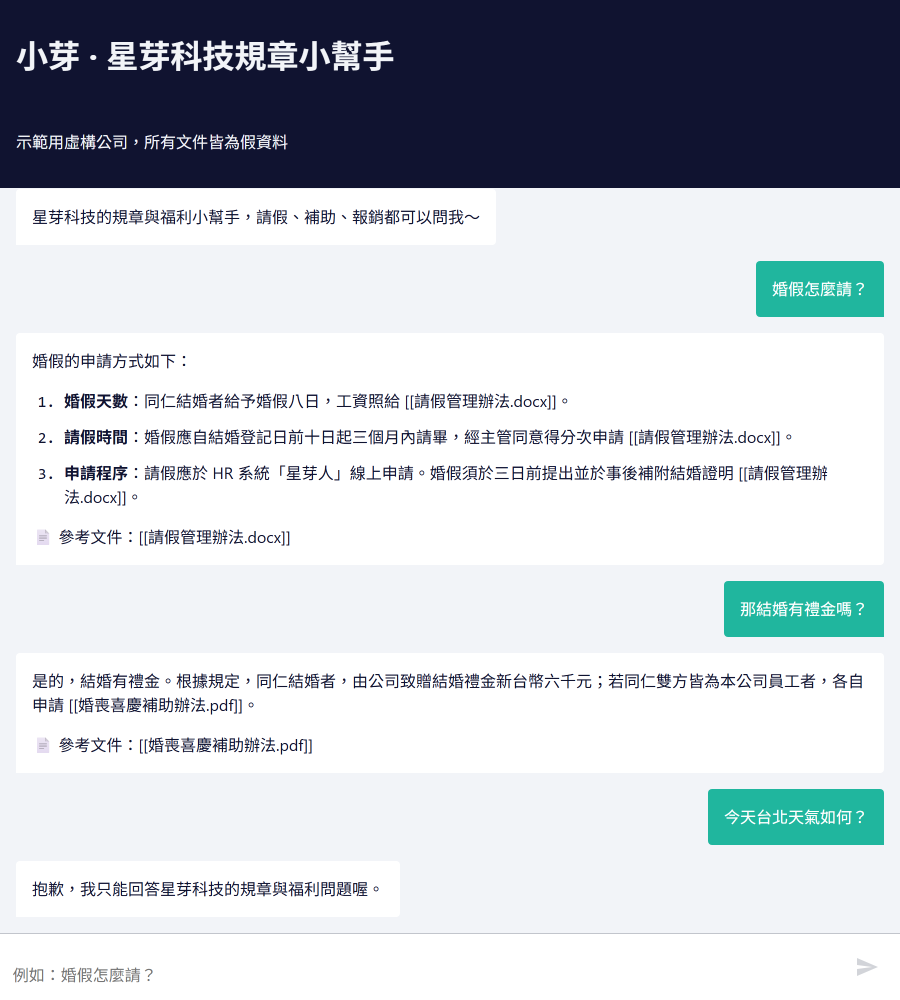
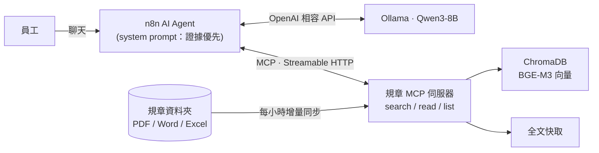
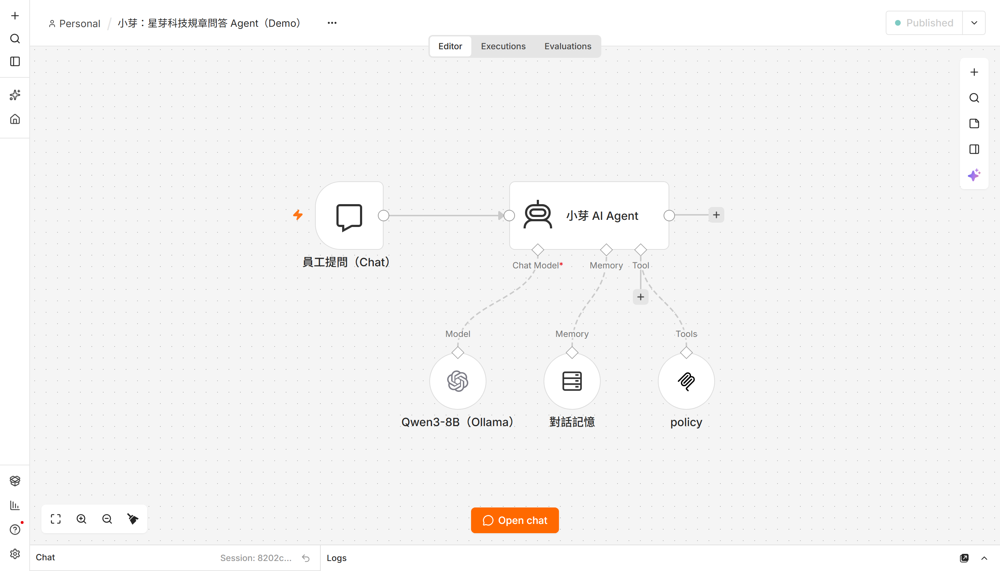

# 小芽：企業規章問答 Agent（MCP × n8n × 本地 LLM）

> ⚠️ 示範專案：「星芽科技」是虛構公司，`data/docs/` 裡的規章全部是假資料。

員工用自然語言問公司制度（請假、補助、報銷……），Agent **一定先查文件再回答**，每個數字都附出處；文件沒寫的不猜，跟公司無關的問題直接拒答。整套跑在本機：Ollama（Qwen3-8B + BGE-M3）、ChromaDB、n8n（Docker）。



## 架構





## 設計重點

| 問題 | 做法 |
|---|---|
| 小切塊找得準，但會切掉但書 | **Small-to-big**：256 token 切塊（重疊 30）召回前 50 段 → 依文件聚合排序 → 最相關的那份直接回傳**全文**，其餘回傳段落 |
| 文件會更新、會刪除 | 背景每小時比對修改時間：改過的重建索引、刪掉的移出索引；全文另外快取，重啟不必重建 |
| LLM 憑常識亂答 | Prompt 規定「先查再答」、每句標 `[[檔名]]`、文件沒寫就請員工找人資、無關問題拒答 |
| 追問時模型拿上一題的文件直接說「找不到」 | Prompt 要求每題重新查；Python 版 agent 另有 harness 檢查：沒查任何文件就下結論，會被退回去先查 |
| 格式多 | PDF（修正中文斷行）、Word、Excel（每列轉成「欄位：值」，切塊後仍看得懂） |

## 驗收（`eval/questions.yaml`，11 題）

每題檢查三件事：有沒有看過正確文件的全文、引用的檔名對不對、答案關鍵字對不對；另有「應拒答」「應回答找不到」「追問」題。

| 版本 | 改了什麼 | 通過 | 平均耗時 |
|---|---|---|---|
| v1 | 基本 prompt | 3/10 | ~6s |
| v2 | 強制讀全文、福利含特約商店、只寫文件有的內容、引用格式 | 7/10 | ~6s |
| v3 | 新增追問題；搜尋直接附前 2 名全文（small-to-big）；harness 檢查 | 8/11 | ~5s |
| **v4** | 只附第 1 名全文、只回前 3 名（太多全文會讓 8B 模型離題） | **9/11** | **~4s** |
| v4 + 思考模式 | Qwen3 thinking | 9/11 | ~17s |

跑法：`uv run python agent/run_agent.py --eval`（結果寫到 `eval/results.json`）

**還沒過的 2 題（8B 模型推理的限制，誠實列出）**
- 「考績 A 年終幾個月？」條文是「1.5 個月為基準 × 1.5 倍」，模型答 1.5，沒算出 2.25
- 「35 歲可以每年健檢嗎？」條文是 40 歲以上才每年，模型答可以

可能的改法：換更大的模型、把「條件判斷／計算」交給程式（例如結構化抽取年齡門檻再比對），或加一步自我檢查。

## 快速開始

需要：Ollama、Docker Desktop、[uv](https://docs.astral.sh/uv/)

```bash
ollama pull bge-m3 && ollama pull qwen3:8b
uv sync
uv run python scripts/make_fake_docs.py      # 產生假規章
uv run policy-mcp                            # MCP 伺服器：http://127.0.0.1:8000/mcp

# 只用 Python 問答 / 驗收
uv run python agent/run_agent.py "婚假怎麼請？"
uv run python agent/run_agent.py --eval

# n8n 版
cd n8n && docker compose up -d               # http://localhost:5678
# 匯入 n8n/workflows/policy_agent.json，建立 OpenAI 憑證：
#   Base URL = http://host.docker.internal:11434/v1，API Key 隨便填
```

## 踩過的坑

- **n8n 的 Ollama 節點 + Qwen3**：思考模式會把工具呼叫吃掉，回覆變空白。改用 OpenAI 相容節點，`extraBody` 加 `{"reasoning_effort": "none"}`。
- **MCP 節點名稱**：n8n 會用節點名稱當工具名前綴，中文名稱會變成 `______MCP_search...`，模型呼叫的名字對不上就被丟掉。節點用英文命名，改名後要重啟 n8n（工具清單有快取）。
- **FastMCP 的 Host 檢查**：從 Docker 用 `host.docker.internal` 連進來會被 DNS rebinding 防護擋掉，demo 環境關閉它（正式環境應改設 `allowed_hosts`）。

## 目錄

```
src/policy_mcp/   MCP 伺服器（loaders / indexer / server）
agent/            system prompt、Python 版 agent 與驗收
eval/             驗收題目與結果
n8n/              docker-compose、匯出的工作流
scripts/          假資料產生、n8n 管理、截圖
```
