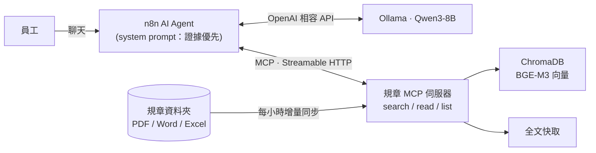
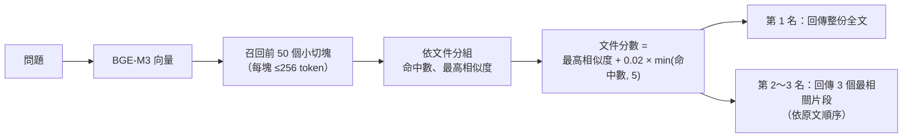
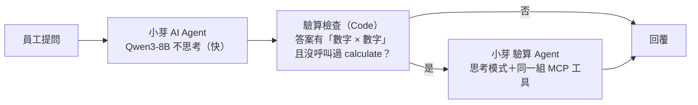
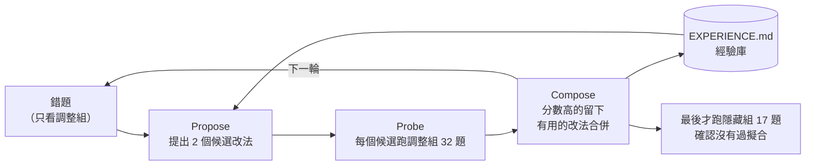

# 小芽：企業規章問答 Agent（MCP × n8n × 本地 LLM）

> ⚠️ 示範專案：「星芽科技」是虛構公司，`data/docs/` 裡的規章全部是假資料。

員工用自然語言問公司制度（請假、補助、報銷……），Agent **一定先查文件再回答**，每個數字都附出處；文件沒寫的不猜，跟公司無關的問題直接拒答。整套跑在本機：Ollama（Qwen3-8B + BGE-M3）、ChromaDB、n8n（Docker）。


回答裡的「參考文件」是可以點的檔案卡片，點下去直接開原始規章（MCP 伺服器的 `/docs/<檔名>`）。Agent 內部仍用 `[[檔名]]` 標出處（方便評分和程式檢查），n8n 最後的「回覆」節點才把它換成卡片。

## 改善前後差異（一眼看懂）

同一個模型（Qwen3-8B，本機），模型本身完全沒訓練，只改 prompt 和流程（harness）。

| 指標 | 改善前（v0：手動調好的版本） | 改善後（v5：改進循環 4 輪） | 差異 |
|---|---|---|---|
| 調整組 38 題（改進時看得到錯題） | 25/32 ※ | 36/38 | 大幅進步，但這組有被「針對」過 |
| 第 1 批隱藏組 17 題（沒看過錯題） | 14/17 | 16/17（v3a） | +2 題 |
| 第 2 批隱藏組 17 題（全新題目） | 13/17 | 14/17 | +1 題，**在誤差範圍內** |
| 平均回答時間 | 4.2～4.7 秒 | 6.4～7.5 秒 | 慢約 2～3 秒（涉及數字的題目才開思考驗算） |
| 參考上限：全程思考 | | 17/17（第 1 批隱藏組） | 每題 19.5 秒，太慢不採用 |

※ v0 是在調整組還只有 32 題時跑的。

**有改善的**：多步計算（基準 × 倍數 × 月薪）、年資／年齡門檻判斷、口語稱謂對到條文（奶奶 → 祖父母）、採購／撥款類問題不再被誤判成無關而拒答。

**沒改善或還有問題的**：
- 名單外的對象（「叔叔過世可以請喪假嗎？」條文沒列叔叔）仍會被硬套成「可以」，改善前後都錯
- 追問題只靠上一輪讀過的文件回答時，評分規則判錯（答案內容其實對）
- v5 多了一個副作用：明顯無關的問題（規劃日本旅遊）會先查文件再說找不到，而不是直接拒答
- 每次跑分同一題可能有 ±1 題的浮動，所以隱藏組 +1 題不能當作確定的進步


## 架構




## 設計重點

| 問題 | 做法 |
|---|---|
| 小切塊找得準，但會切掉但書 | **Small-to-big**：256 token 切塊（重疊 30）召回前 50 段 → 依文件聚合排序 → 最相關的那份直接回傳**全文**，其餘回傳段落 |
| 文件會更新、會刪除 | 背景每小時比對修改時間：改過的重建索引、刪掉的移出索引；全文另外快取，重啟不必重建 |
| LLM 憑常識亂答 | Prompt 規定「先查再答」、每句標 `[[檔名]]`、文件沒寫就請員工找人資、無關問題拒答 |
| 追問時模型拿上一題的文件直接說「找不到」 | Prompt 要求每題重新查；Python 版 agent 另有 harness 檢查：沒查任何文件就下結論，會被退回去先查 |
| 引用出處要讓人看得懂 | 模型輸出 `[[檔名]]`，n8n 回覆節點換成可點擊的檔案卡片（📘 Word／📕 PDF／📗 Excel），連到 MCP 伺服器的 `/docs/<檔名>` 開原檔（只開放規章資料夾裡的檔案） |
| 格式多 | PDF（修正中文斷行）、Word、Excel（每列轉成「欄位：值」，切塊後仍看得懂） |

## Small-to-big 檢索怎麼做（`src/policy_mcp/indexer.py`、`server.py`）

核心想法：**用小塊找、用大塊答**。小塊的向量比較「純」，搜得準；但回答需要完整上下文（但書、例外、申請條件），所以找到之後要放大回去。



1. **建索引：小切塊**
   - 先依句號、分號、換行切成句子，再把句子裝進 256 token 的箱子（用 tiktoken 估算）。以句子為單位，所以不會把一句話切成兩半
   - 相鄰兩塊重疊約 30 token：下一塊會帶上一塊結尾的句子，跨塊的條文不會斷掉
   - 每一塊記錄 `file`（哪份文件）和 `pos`（第幾塊），存進 ChromaDB（cosine 距離）
2. **查詢：先多撈小塊**
   - 問題向量化後，從 ChromaDB 撈前 50 個最像的小切塊。撈多一點是為了讓「同一份文件有好幾段都相關」這個訊號浮出來
3. **聚合：小塊歸回文件**
   - 依 `file` 分組，算每份文件的命中段數和最高相似度
   - 文件分數＝最高相似度＋0.02 × 命中數（最多算 5 段）。以最佳片段為主，多處相關的文件小幅加分
4. **放大：回傳大塊**
   - 第 1 名直接回傳**整份全文**（全文另外存在快取，不用重新讀檔），條件與但書不會被切掉
   - 第 2、3 名只回傳 3 個最相關片段，依原文順序排好，需要時 agent 再用 `read_specific_document` 讀全文
   - 文件超過 4,000 字就不附全文，改回傳片段（避免塞爆小模型的 context）

**為什麼這樣調**（看驗收數據決定的）
- 只回片段 → 模型常常跳過「讀全文」，漏掉但書（v2：7/10）
- 前 2 名都附全文 → 8B 模型被資訊淹沒，把所有規章都整理一遍（v3）
- 只附第 1 名全文、只回前 3 名 → 9/11（v4）

**限制**：這批規章每份都很短，所以「放大」直接放大到整份文件。正式環境的長文件（幾十頁的手冊）應該放大到「所屬章節」或「前後幾塊」，而不是整份。可調參數：`FULLTEXT_DOCS`、`FULLTEXT_MAX_CHARS`、`TOP_FILES`（環境變數）。

## 計算機工具（`src/policy_mcp/calc.py`）

8B 模型心算常出錯（例如 1.5 × 1.5 答 1.5），所以 MCP 多提供一個 `calculate` 工具：

- 支援 `+ - * / ** ( )`、比較（`35 >= 40` → 不成立）、`and / or`、`round/min/max/abs`，也接受 `×`、`÷` 和千分位逗號
- **用 Python AST 白名單解析，不用 `eval`**：`__import__("os")` 這類程式碼會被拒絕；次方上限防止算爆

## 驗收（`eval/questions.yaml`，14 題）

每題檢查三件事：有沒有看過正確文件的全文、引用的檔名對不對、答案關鍵字對不對；另有「應拒答」「應回答找不到」「追問」題。

| 版本 | 改了什麼 | 通過 | 平均耗時 |
|---|---|---|---|
| v1 | 基本 prompt | 3/10 | ~6s |
| v2 | 強制讀全文、福利含特約商店、只寫文件有的內容、引用格式 | 7/10 | ~6s |
| v3 | 新增追問題；搜尋直接附前 2 名全文（small-to-big）；harness 檢查 | 8/11 | ~5s |
| **v4** | 只附第 1 名全文、只回前 3 名（太多全文會讓 8B 模型離題） | **9/11** | **~4s** |
| v4 + 思考模式 | Qwen3 thinking | 9/11 | ~17s |
| v6 | 新增 3 題計算題（共 14 題）＋ `calculate` 工具＋ harness 檢查「答案有算式卻沒用計算機 → 退回驗算」 | 10/14 | ~4s |
| **v6 + 思考模式** | 同上，開 Qwen3 thinking | **14/14** | ~24s |

**計算機的教訓**：光是「給工具」不夠。v5 只加了 `calculate` 和 prompt，14 題裡模型只用了 1 次，還把公式列錯（漏乘基準 1.5、加班沒分段）。真正有效的是兩件事一起：
1. **Harness 檢查**：答案裡出現「數字 × 數字」這類算式、卻沒呼叫過 `calculate`，就退回去要求「重新確認條文公式，再用計算機算」
2. **思考模式**：模型要先想清楚公式（基準 × 倍數、前 2 小時和第 3 小時分段），計算機只負責算對數字

不開思考模式時，模型被要求驗算後還是列錯公式（例如年終只算 40,000 × 1.2），所以 10/14。**取捨**：要快（~4 秒）就關思考模式、接受計算題可能錯；要準（14/14）就開，每題約 24 秒。實務上可以只在問題需要計算時才開。

跑法：`uv run python agent/run_agent.py --eval`（結果寫到 `eval/results.json`）

**v4 時還沒過的 2 題（v6 用計算機＋思考模式解掉了）**
- 「考績 A 年終幾個月？」條文是「1.5 個月為基準 × 1.5 倍」，模型答 1.5，沒算出 2.25
- 「35 歲可以每年健檢嗎？」條文是 40 歲以上才每年，模型答可以

v6 的做法見上方「計算機的教訓」。

## n8n 版的驗算檢查（`scripts/n8n_build_workflow.py`）

n8n 的 Agent 節點沒有辦法在中途插入檢查，所以把 Python 版的 harness 檢查改成「Agent 後面接分支」：



- 主 Agent 開 `returnIntermediateSteps`，檢查節點就能看到這一輪呼叫過哪些工具
- 算式偵測和 Python 版用同一條規則：`數字（萬/千）（元/小時/個月/倍/日）運算子 數字`，例如「4 萬元 × 1.2」「200元 × (1 + 1/3)」；「婚假共八日」「4,000 元」不會誤判
- 驗算 Agent 拿到「原問題＋草稿答案」，被要求逐字找出條文、列完整公式（基準、分段）、用 `calculate` 算每個數字
- 不需要計算的問題只走快速路徑（約 4 秒），只有被抓到的題目才多花思考模式的時間
- 整條工作流由腳本產生（`python scripts/n8n_build_workflow.py`），可重複執行

**調整過程**（n8n 版也用同一份 14 題驗收：`python eval/run_n8n_eval.py`，只看引用與答案，看不到工具呼叫）

| 版本 | 改了什麼 | n8n 通過 |
|---|---|---|
| n1 | 驗算 Agent 用 OpenAI 相容節點，拿到「問題＋草稿」 | 計算題仍錯（年終 B+ 答 48,000） |
| n2 | 驗算 Agent 改原生 Ollama 節點（`think: true`） | 仍錯，模型照抄草稿的公式 |
| n3 | **不給草稿**（避免錨定在錯的公式上） | 12/14：計算題對了；但「年終幾個月」「35 歲每年健檢？」答案裡沒有算式，沒被抓到 |
| n4 | 檢查條件加上「問題本身有數字或問『幾／多少』」 | 12/14：被抓到了，但驗算 Agent **沒查文件就編**，還引用不存在的檔名 |
| n5 | 試 `forceToolCallOnFirstIteration` | 沒效果（Ollama 節點沒照做） |
| **n6** | **把主 Agent 查到的文件內容直接交給驗算 Agent**，並規定只能引用這些檔名 | **13/14** |

- 不需要數字的問題走快速路徑（約 2～6 秒），涉及數字的才走驗算（約 12～17 秒）
- 驗算 Agent 在 n8n 裡仍然**很少真的呼叫 `calculate`**，正確率主要來自思考模式＋正確的文件內容。Python 版是同一段對話裡被退回，比較會用計算機

**剩下的 1 題：加班費，其實是文件寫得有歧義**
- 條文寫「前二小時按平日每小時工資加給三分之一」。模型只算了「加給」的部分（200 × 1/3 × 2 + 200 × 2/3 × 1 = 266.67），驗收預期的是含原本工資的總額（866.67）
- 兩種讀法在字面上都說得通。真實規章也常有這種問題，這類題目應該在條文裡寫清楚（例如「每小時給付 1⅓ 倍工資」），或在回答時把兩種讀法都說明。示範資料保留原文，不為了過關改題目

## 自動改進循環（仿 Harness²，`harness/`）

手動調了十幾個版本之後，把「改 → 測 → 留下有用的」這個循環做成固定流程，概念來自 [Harness²](https://github.com/google-research/harness2)：不動模型權重，只改模型外面那一圈（prompt、工具、檢查規則）。



| 元件 | 檔案 | 說明 |
|---|---|---|
| 候選 harness | `harness/candidates/<名稱>/` | `system_prompt.md`、`env.yaml`（開關）、`PROPOSAL.md`（改了什麼、根據哪些錯題） |
| 可以改的範圍 | `env.yaml` | `THINK`（思考模式）、`CALC_CHECK`（驗算檢查）、`RECHECK_MODE`（inline 同對話重算／fresh 開新對話只給文件）、`RECHECK_THINK`（只在驗算時思考）、`NUMERIC_TRIGGER`（問題有數字也觸發驗算） |
| 調整組 | `eval/tune.yaml`（32 題） | 改進循環**只能看這組的錯題** |
| 隱藏組 | `eval/holdout.yaml`（17 題） | 題型類似但題目不同；`loop.py fails --split holdout` 會直接拒絕，避免偷看 |
| 成績表 | `harness/scoreboard.csv` | 每次 probe 一列：候選、組別、通過數、平均秒數 |
| 經驗庫 | `harness/EXPERIENCE.md` | 每次改動的 change / verdict / lesson，下一輪 Propose 先讀 |

**誰來 Propose？** 這一版由開發用的 AI 助理（Claude）讀錯題和經驗庫後寫候選，`loop.py` 負責跑分和記錄；之後可以換成 API 自動呼叫。**目標**：不開思考模式（約 4 秒一題）的前提下，把正確率拉到接近全程思考模式（約 20 秒一題）。

### 第一次跑的結果（3 輪，詳細過程在 `harness/EXPERIENCE.md`）

| 候選 | 改了什麼 | 調整組 32 題 | 隱藏組 17 題 | 平均秒數 |
|---|---|---|---|---|
| v0 | 起點：手動調好的 prompt，快速模式 | 25 | 14 | 4.2 |
| v1a | 快慢雙路徑：問題涉及數字才驗算；驗算開新對話、不給草稿、只在驗算時思考 | 29 | | 7.5 |
| v1b | Prompt：稱謂對照（奶奶→祖父母）、金額千分位、找不到固定句 | 27 | | 4.1 |
| v2 | Compose：v1a ＋ v1b ＋ 查文件檢查改嚴格 | 30 | | 7.5 |
| **v3a** | 驗算 prompt：門檻結論要跟計算機一致、中文數字核對位數、不補文件沒寫的流程 | **32** | **16** | 7.7 |
| v3b | v3a ＋ 工具端把中文數字加註成「四千（4,000）元」 | 28（淘汰） | | 7.4 |
| vthink | 參考上限：全程思考模式 | | 17 | 19.5 |

- 隱藏組也從 14 進步到 16，改動不是只背了調整組
- v3a 用約 40% 的時間拿到接近全程思考的分數
- v3b 被淘汰：模型會把「六（6）日」這種加註格式照抄進答案。看起來合理的結構性改法也要實測
- v3a 在隱藏組錯的 1 題（採購問題被當成無關而拒答）是調整組沒涵蓋的新類型；下一輪要把這類問法補進調整組，並換一批新的隱藏組

### 第 4 輪：補上隱藏組找到的盲點

第 1 批隱藏組找到一個新的錯誤類型（採購問題被當成無關問題拒答）。做法：**不拿隱藏組原題來改**，而是換不同問法把採購、報帳、撥款、尾牙等 6 題補進調整組（32 → 38 題），並換上全新的第 2 批隱藏組（`eval/holdout2.yaml`）。

| 候選 | 改了什麼 | 調整組 38 題 | 第 2 批隱藏組 17 題 | 平均秒數 |
|---|---|---|---|---|
| v3a | 上一輪最佳 | 34 | 13 | 6.1～7.3 |
| v4a | Prompt：公司問題範圍加上採購、撥款、公司活動；不確定就先查 | 35 | | 7.4 |
| v4b | Harness：沒查就拒答時，程式自己搜一次，相關度 ≥ 0.5 就退回 | 35 | | 7.8 |
| **v5** | Compose：v4a ＋ v4b ＋ 問題含「公司、員工…」一律不准不查就拒答 | **36** | **14** | 6.4～7.5 |
| v0（參考） | 起點 | | 13 | 4.7 |

- 第 2 批隱藏組只多對 1 題，在誤差範圍內，不能說有顯著進步。誠實結論：調整組的進步大，泛化的進步小
- 隱藏組又找到新類型：「叔叔過世可以請喪假嗎？」條文沒列叔叔，模型卻套用別的親屬列說可以。記錄在 `harness/EXPERIENCE.md`，留給下一輪
- v5 已複製成正式版（`agent/system_prompt.md`、`agent/recheck_prompt.md`），**n8n 版也讀同一份檔案**

### n8n 版套用 v5

`scripts/n8n_build_workflow.py` 直接讀 `agent/system_prompt.md` 和 `agent/recheck_prompt.md` 產生工作流，所以 Python 版選出來的 prompt 不用手動貼進 n8n。驗算檢查節點也跟 Python 版對齊（拒答不驗算、只把含 `[[檔名]]` 的文件內容交給驗算 Agent）。

- n8n 版在 38 題調整組：**36/38、35/38**（兩次獨立跑，平均 8.6～9.0 秒；`python eval/run_n8n_eval.py --questions eval/tune.yaml`）。另有一次跟別的 GPU 工作同時跑，掉到 33/38：本機 8B 模型在負載下輸出會變，正式跑分要獨占 GPU
- 錯的 2 題都是「應該說找不到」的題目，其中「尾牙」是因為 n8n 版沒有 v4b 的程式拒答檢查（只有 prompt）
- n8n 的評分沒有檢查「有沒有讀全文」（拿不到 Python 版那麼細的工具紀錄），所以比 Python 版寬鬆一點

```bash
python harness/loop.py new v1a --from v0      # 複製候選
python harness/loop.py probe v1a              # 跑調整組
python harness/loop.py fails v1a              # 看錯題（只限調整組）
python harness/loop.py diff v0 v1a            # 逐題比較
python harness/loop.py probe v2 --split holdout2  # 最後才跑隱藏組（第 1 批已用過）
python harness/loop.py rescore v2 --split tune     # 評分規則修正後，用存下的答案重新評分
```

## 快速開始

需要：Ollama、Docker Desktop、[uv](https://docs.astral.sh/uv/)

```bash
ollama pull bge-m3 && ollama pull qwen3:8b
uv sync
uv run python scripts/make_fake_docs.py      # 產生假規章
uv run policy-mcp                            # MCP 伺服器：http://127.0.0.1:8000/mcp

# 只用 Python 問答 / 驗收
uv run python agent/run_agent.py "婚假怎麼請？"
uv run python agent/run_agent.py --eval

# n8n 版
cd n8n && docker compose up -d               # http://localhost:5678
# 建立兩個憑證：OpenAI（Base URL = http://host.docker.internal:11434/v1，API Key 隨便填）、Ollama（http://host.docker.internal:11434）
# 再用腳本產生工作流（含驗算分支）：python scripts/n8n_build_workflow.py
```

## 踩過的坑

- **n8n 回覆一片空白**：一開始以為是 Qwen3 的思考模式把工具呼叫吃掉，所以改用 OpenAI 相容節點、`extraBody` 加 `{"reasoning_effort": "none"}`。後來在 n8n 和 Ollama 中間架一個記錄用的 proxy，才發現**主因是下一條的工具名前綴**：模型呼叫的工具名對不上，Ollama 就把呼叫丟掉、回空字串。教訓：猜原因之前，先看實際送出去的 request。
- **MCP 節點名稱**：n8n 會用節點名稱當工具名前綴，中文名稱會變成 `______MCP_search...`，模型呼叫的名字對不上就被丟掉。節點用英文命名，改名後要重啟 n8n（工具清單有快取）。
- **FastMCP 的 Host 檢查**：從 Docker 用 `host.docker.internal` 連進來會被 DNS rebinding 防護擋掉，demo 環境關閉它（正式環境應改設 `allowed_hosts`）。

## 目錄

```
src/policy_mcp/   MCP 伺服器（loaders / indexer / server）
agent/            system prompt、Python 版 agent 與驗收
eval/             驗收題目與結果
n8n/              docker-compose、匯出的工作流
scripts/          假資料產生、n8n 管理、截圖
```
