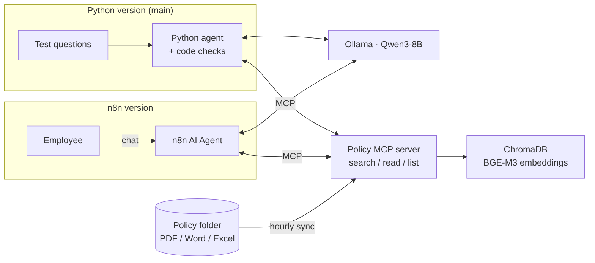

# Sprout: a company-policy Q&A agent

English | [繁體中文](README.zh-TW.md)

> ⚠️ Demo project. "Sprout Tech" (星芽科技) is a fictional company, and every policy document in `data/docs/` is synthetic.

Employees ask about company rules the way they would ask a colleague, for example "How many days of wedding leave do I get?" or "How is my year-end bonus calculated?". Sprout looks up the policy documents before it answers and cites the source for every number. If the documents don't cover something, it says so instead of guessing, and it politely declines questions that have nothing to do with the company.

The whole system runs locally, so no data leaves the machine: Ollama (Qwen3-8B) for the model, ChromaDB for vector search, n8n for the chat interface. The policies and questions are in Chinese.


## How it works

1. An employee asks a question in the chat.
2. The agent calls the policy MCP server to search the documents (MCP is a standard way for AI agents to call external tools).
3. The server finds the most relevant policy and returns the whole document or the matching passages.
4. The model answers from those passages and cites each one. For questions that involve a calculation, code checks the math again.



There are two versions, and both use the same MCP server:

- **The Python version** is the main one. All the eval scores below come from it.
- **The n8n version** runs the same approach as an n8n workflow, closer to how a company would actually deploy it. The code checks added in the later rounds (such as formula checking) have not been ported to it yet.


## How I know the answers are right

There are two kinds of question sets:

- **Tuning set (58 questions):** I could see the failures while improving the agent, like practice questions.
- **Hidden sets (5 batches):** never looked at while improving, only used to check whether a change really helped, like the real exam.

The model itself was never retrained. Only the prompts and the surrounding code changed. Current scores:

<!-- EVAL:START -->
<!-- Generated by scripts/run_eval.py. Do not edit by hand. -->
**Latest eval** (Python agent, version `v11d`, model `qwen3:8b (thinking only when re-checking)`; [how to read these scores](docs/evaluation.md#分數怎麼看), in Chinese)

- Tuning set: **58/58** (100%), 9.7 s per question, 2026-10-27, CI minimum 57
- Hidden batch 1: **15/17** (88.2%), 10.1 s per question, 2026-10-27, CI minimum 14
- Hidden batch 2: **16/17** (94.1%), 7.3 s per question, 2026-10-27, CI minimum 15
- Hidden batch 3: **7/9** (77.8%), 6.9 s per question, 2026-10-27, CI minimum 6
- Hidden batch 4: **14/14** (100%), 10.7 s per question, 2026-10-27, CI minimum 13
- Hidden batch 5: **14/14** (100%), 10.6 s per question, 2026-10-27, CI minimum 13
<!-- EVAL:END -->

What I should be upfront about:

- When a hidden batch exposed a new kind of mistake, the next round added reworded versions of it to the tuning set. So only each batch's first run counts as truly unseen questions.
- Batch 5 was written by the same AI that wrote the code checks, so its perfect score is probably optimistic.
- Rerunning the same question can change the result by about one question, so a one-question difference doesn't prove anything either way.

Compared with the first version, the tuning set went from 25/32 to 58/58, hidden batch 1 from 14/17 to 15/17, and hidden batch 2 from 13/17 to 16/17. The cost is speed: answers went from 4 to 5 seconds to roughly 7 to 11 seconds, because questions with numbers get an extra checking step. What changed in each round is in [docs/harness.md](docs/harness.md) (in Chinese).

## Design decisions

| Problem | Fix |
|---|---|
| Small chunks miss the exceptions written further down a policy | Search with small chunks, then return the full text of the best-matching policy (small-to-big retrieval) |
| Policies get updated and deleted | Files are checked every hour and the index is rebuilt for anything that changed |
| The model answers from general knowledge | It must search before answering and cite every sentence; if the documents don't say, it refers the employee to HR |
| Follow-up questions get "not found" without a new search | A code check sends the answer back if the agent concluded without reading any document |
| Wrong arithmetic | Code finds the formula in the policy and recomputes; a mismatch goes back for another try |
| Everyday family terms don't match the policy wording ("grandma", "my husband's father") | A kinship lookup table in code maps them to the terms the policy uses |
| Citations are hard to follow | The n8n version turns citations into clickable file cards that open the original document |
| Many file formats | PDF, Word and Excel are supported |

## Quick start

Requirements: Ollama, Docker Desktop, [uv](https://docs.astral.sh/uv/)

```bash
ollama pull bge-m3 && ollama pull qwen3:8b
uv sync
uv run python scripts/make_fake_docs.py      # generate the synthetic policies
uv run policy-mcp                            # MCP server at http://127.0.0.1:8000/mcp

# Python agent: ask a question / run the test questions
uv run python agent/run_agent.py "婚假怎麼請？"   # "How do I apply for wedding leave?"
uv run python agent/run_agent.py --eval

# Full eval (updates scores, baseline and the score block in both READMEs), plus the CI checks (no model needed)
uv run python scripts/run_eval.py
uv run python -m pytest -q tests && uv run python scripts/check_regression.py

# n8n version
cd n8n && docker compose up -d               # http://localhost:5678
# Create two credentials: OpenAI (Base URL = http://host.docker.internal:11434/v1, any API key) and Ollama (http://host.docker.internal:11434)
# Then generate the workflow (with the checking branch): python scripts/n8n_build_workflow.py
```

## More docs (in Chinese)

- [Evaluation and CI](docs/evaluation.md): how questions are graded, what CI checks, how to read the scores
- [Improvement loop](docs/harness.md): what changed in each round and how the scores moved
- [n8n version](docs/n8n.md): the checking branch and question routing
- [Retrieval](docs/retrieval.md): small-to-big retrieval parameters and the calculator tool
- [Pitfalls](docs/pitfalls.md): problems hit while wiring n8n, Ollama and MCP together
- [Project structure](docs/structure.md): what each folder holds

## License

[MIT](LICENSE)
