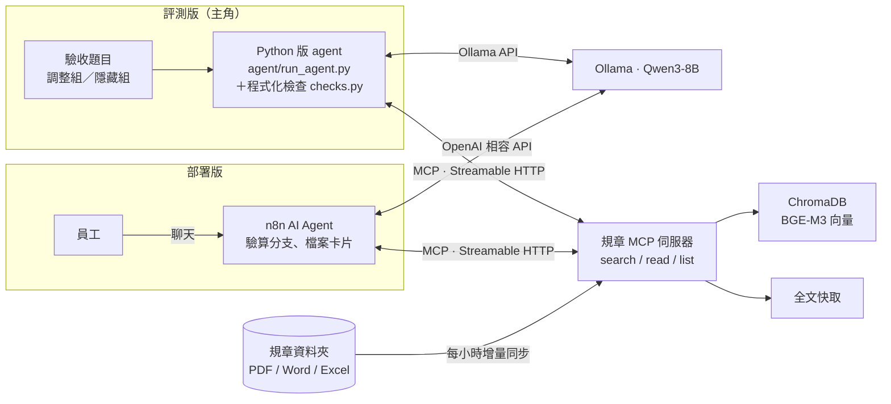

# 小芽：企業規章問答 Agent（MCP × n8n × 本地 LLM）

> ⚠️ 示範專案：「星芽科技」是虛構公司，`data/docs/` 裡的規章全部是假資料。

員工用自然語言問公司制度（請假、補助、報銷……），Agent **一定先查文件再回答**，每個數字都附出處；文件沒寫的不猜，跟公司無關的問題直接拒答。整套跑在本機：Ollama（Qwen3-8B + BGE-M3）、ChromaDB、n8n（Docker）。


<!-- EVAL:START -->
<!-- 這段由 scripts/run_eval.py 自動產生，請不要手動修改 -->
**最新評測**（Python 版 agent）：候選 `v11d`，模型 `qwen3:8b（只在驗算時思考）`（[怎麼看這些分數](docs/evaluation.md#分數怎麼看)）

- 調整組 tune：**58/58**（100%），平均 9.7 秒／題，2026-10-27，CI 基準 ≥ 57
- 第 1 批隱藏組 holdout：**15/17**（88.2%），平均 10.1 秒／題，2026-10-27，CI 基準 ≥ 14
- 第 2 批隱藏組 holdout2：**16/17**（94.1%），平均 7.3 秒／題，2026-10-27，CI 基準 ≥ 15
- 第 3 批隱藏組 holdout3：**7/9**（77.8%），平均 6.9 秒／題，2026-10-27，CI 基準 ≥ 6
- 第 4 批隱藏組 holdout4：**14/14**（100%），平均 10.7 秒／題，2026-10-27，CI 基準 ≥ 13
- 第 5 批隱藏組 holdout5：**14/14**（100%），平均 10.6 秒／題，2026-10-27，CI 基準 ≥ 13
<!-- EVAL:END -->

> 📌 **隱藏組怎麼看**：每一批隱藏組找到的新錯誤類型，下一輪都會換個問法補進調整組，所以只有「剛換上那一批第一次跑」的分數是真的沒看過的題目。第 5 批是目前唯一還沒被借題的，但它是寫第 8 輪檢查的同一個 agent 出的題，14/14 偏樂觀。細節見[改善前後完整表格](docs/harness.md#改善前後差異完整表格與各輪說明)。

## 架構

同一台 MCP 伺服器，兩種用法：**Python 版 agent 是主角**（評測、CI、上面的分數都是它），n8n 版把同一套 prompt 和檢查搬到貼近公司實際部署的工作流上。



兩版共用 `agent/system_prompt.md`；第 8 輪新加的程式檢查（例如 FORMULA_CHECK）目前只在 Python 版，還沒移植到 n8n。


## 設計重點

| 問題 | 做法 |
|---|---|
| 小切塊找得準，但會切掉但書 | **Small-to-big**：256 token 切塊（重疊 30）召回前 50 段 → 依文件聚合排序 → 最相關的那份直接回傳**全文**，其餘回傳段落 |
| 文件會更新、會刪除 | 背景每小時比對修改時間：改過的重建索引、刪掉的移出索引；全文另外快取，重啟不必重建 |
| LLM 憑常識亂答 | Prompt 規定「先查再答」、每句標 `[[檔名]]`、文件沒寫就請員工找人資、無關問題拒答 |
| 追問時模型拿上一題的文件直接說「找不到」 | Prompt 要求每題重新查；Python 版 agent 另有 harness 檢查：沒查任何文件就下結論，會被退回去先查 |
| 引用出處要讓人看得懂 | 模型輸出 `[[檔名]]`，n8n 回覆節點換成可點擊的檔案卡片（📘 Word／📕 PDF／📗 Excel），連到 MCP 伺服器的 `/docs/<檔名>` 開原檔（只開放規章資料夾裡的檔案） |
| 格式多 | PDF（修正中文斷行）、Word、Excel（每列轉成「欄位：值」，切塊後仍看得懂） |

## 改善前後（摘要）

同一個模型（Qwen3-8B，本機），模型本身沒有訓練，只改 prompt 和流程（harness），改進循環跑了 8 輪：

- 調整組：25/32（v0）→ 58/58（v11d）。這組改進時看得到錯題，有被「針對」過
- 隱藏組：第 1 批 14/17 → 15/17、第 2 批 13/17 → 16/17
- 代價：平均回答時間從 4～5 秒變成約 7～11 秒（數字題才開思考驗算）
- 每一輪改了什麼、還沒解決的問題：[改善前後完整表格](docs/harness.md#改善前後差異完整表格與各輪說明)

## 快速開始

需要：Ollama、Docker Desktop、[uv](https://docs.astral.sh/uv/)

```bash
ollama pull bge-m3 && ollama pull qwen3:8b
uv sync
uv run python scripts/make_fake_docs.py      # 產生假規章
uv run policy-mcp                            # MCP 伺服器：http://127.0.0.1:8000/mcp

# 只用 Python 問答 / 驗收
uv run python agent/run_agent.py "婚假怎麼請？"
uv run python agent/run_agent.py --eval

# 完整評測（更新分數、基準、README 最上面的分數區塊），以及 CI 跑的檢查（不需要模型）
uv run python scripts/run_eval.py
uv run python -m pytest -q tests && uv run python scripts/check_regression.py

# n8n 版
cd n8n && docker compose up -d               # http://localhost:5678
# 建立兩個憑證：OpenAI（Base URL = http://host.docker.internal:11434/v1，API Key 隨便填）、Ollama（http://host.docker.internal:11434）
# 再用腳本產生工作流（含驗算分支）：python scripts/n8n_build_workflow.py
```

## 文件導覽

- [評測：驗收、CI 與本機跑分](docs/evaluation.md)：14 題驗收的版本演進、CI 檢查什麼、本機一行指令跑完整評測、分數怎麼看
- [自動改進循環（Harness）](docs/harness.md)：「改 → 測 → 留下有用的」流程，第 1～8 輪的候選與分數
- [n8n 版：驗算檢查與分流](docs/n8n.md)：n8n 的驗算分支、規章／數據分流、「沒查就拒答」檢查
- [檢索與計算機工具](docs/retrieval.md)：Small-to-big 檢索的做法與參數，`calculate` 工具
- [踩過的坑](docs/pitfalls.md)：n8n × Ollama × MCP 串接時遇到的問題
- [目錄](docs/structure.md)：各資料夾放什麼

## 授權

[MIT](LICENSE)
