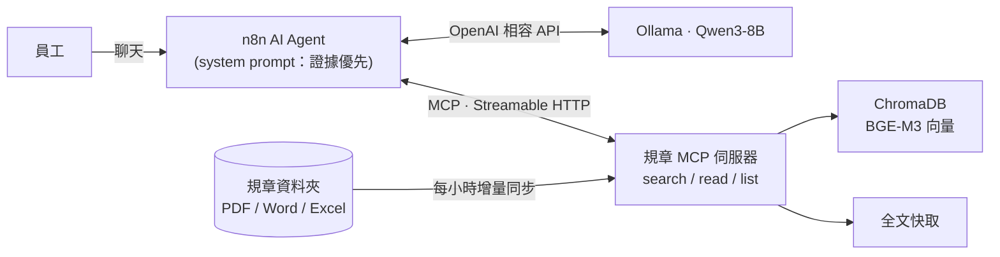
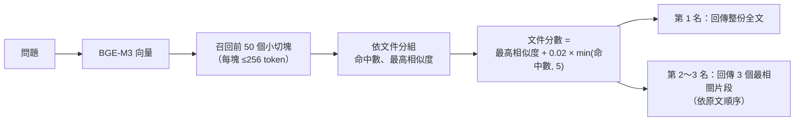

# 小芽：企業規章問答 Agent（MCP × n8n × 本地 LLM）

> ⚠️ 示範專案：「星芽科技」是虛構公司，`data/docs/` 裡的規章全部是假資料。

員工用自然語言問公司制度（請假、補助、報銷……），Agent **一定先查文件再回答**，每個數字都附出處；文件沒寫的不猜，跟公司無關的問題直接拒答。整套跑在本機：Ollama（Qwen3-8B + BGE-M3）、ChromaDB、n8n（Docker）。


## 架構




## 設計重點

| 問題 | 做法 |
|---|---|
| 小切塊找得準，但會切掉但書 | **Small-to-big**：256 token 切塊（重疊 30）召回前 50 段 → 依文件聚合排序 → 最相關的那份直接回傳**全文**，其餘回傳段落 |
| 文件會更新、會刪除 | 背景每小時比對修改時間：改過的重建索引、刪掉的移出索引；全文另外快取，重啟不必重建 |
| LLM 憑常識亂答 | Prompt 規定「先查再答」、每句標 `[[檔名]]`、文件沒寫就請員工找人資、無關問題拒答 |
| 追問時模型拿上一題的文件直接說「找不到」 | Prompt 要求每題重新查；Python 版 agent 另有 harness 檢查：沒查任何文件就下結論，會被退回去先查 |
| 格式多 | PDF（修正中文斷行）、Word、Excel（每列轉成「欄位：值」，切塊後仍看得懂） |

## Small-to-big 檢索怎麼做（`src/policy_mcp/indexer.py`、`server.py`）

核心想法：**用小塊找、用大塊答**。小塊的向量比較「純」，搜得準；但回答需要完整上下文（但書、例外、申請條件），所以找到之後要放大回去。



1. **建索引：小切塊**
   - 先依句號、分號、換行切成句子，再把句子裝進 256 token 的箱子（用 tiktoken 估算）。以句子為單位，所以不會把一句話切成兩半
   - 相鄰兩塊重疊約 30 token：下一塊會帶上一塊結尾的句子，跨塊的條文不會斷掉
   - 每一塊記錄 `file`（哪份文件）和 `pos`（第幾塊），存進 ChromaDB（cosine 距離）
2. **查詢：先多撈小塊**
   - 問題向量化後，從 ChromaDB 撈前 50 個最像的小切塊。撈多一點是為了讓「同一份文件有好幾段都相關」這個訊號浮出來
3. **聚合：小塊歸回文件**
   - 依 `file` 分組，算每份文件的命中段數和最高相似度
   - 文件分數＝最高相似度＋0.02 × 命中數（最多算 5 段）。以最佳片段為主，多處相關的文件小幅加分
4. **放大：回傳大塊**
   - 第 1 名直接回傳**整份全文**（全文另外存在快取，不用重新讀檔），條件與但書不會被切掉
   - 第 2、3 名只回傳 3 個最相關片段，依原文順序排好，需要時 agent 再用 `read_specific_document` 讀全文
   - 文件超過 4,000 字就不附全文，改回傳片段（避免塞爆小模型的 context）

**為什麼這樣調**（看驗收數據決定的）
- 只回片段 → 模型常常跳過「讀全文」，漏掉但書（v2：7/10）
- 前 2 名都附全文 → 8B 模型被資訊淹沒，把所有規章都整理一遍（v3）
- 只附第 1 名全文、只回前 3 名 → 9/11（v4）

**限制**：這批規章每份都很短，所以「放大」直接放大到整份文件。正式環境的長文件（幾十頁的手冊）應該放大到「所屬章節」或「前後幾塊」，而不是整份。可調參數：`FULLTEXT_DOCS`、`FULLTEXT_MAX_CHARS`、`TOP_FILES`（環境變數）。

## 計算機工具（`src/policy_mcp/calc.py`）

8B 模型心算常出錯（例如 1.5 × 1.5 答 1.5），所以 MCP 多提供一個 `calculate` 工具：

- 支援 `+ - * / ** ( )`、比較（`35 >= 40` → 不成立）、`and / or`、`round/min/max/abs`，也接受 `×`、`÷` 和千分位逗號
- **用 Python AST 白名單解析，不用 `eval`**：`__import__("os")` 這類程式碼會被拒絕；次方上限防止算爆

## 驗收（`eval/questions.yaml`，14 題）

每題檢查三件事：有沒有看過正確文件的全文、引用的檔名對不對、答案關鍵字對不對；另有「應拒答」「應回答找不到」「追問」題。

| 版本 | 改了什麼 | 通過 | 平均耗時 |
|---|---|---|---|
| v1 | 基本 prompt | 3/10 | ~6s |
| v2 | 強制讀全文、福利含特約商店、只寫文件有的內容、引用格式 | 7/10 | ~6s |
| v3 | 新增追問題；搜尋直接附前 2 名全文（small-to-big）；harness 檢查 | 8/11 | ~5s |
| **v4** | 只附第 1 名全文、只回前 3 名（太多全文會讓 8B 模型離題） | **9/11** | **~4s** |
| v4 + 思考模式 | Qwen3 thinking | 9/11 | ~17s |
| v6 | 新增 3 題計算題（共 14 題）＋ `calculate` 工具＋ harness 檢查「答案有算式卻沒用計算機 → 退回驗算」 | 10/14 | ~4s |
| **v6 + 思考模式** | 同上，開 Qwen3 thinking | **14/14** | ~24s |

**計算機的教訓**：光是「給工具」不夠。v5 只加了 `calculate` 和 prompt，14 題裡模型只用了 1 次，還把公式列錯（漏乘基準 1.5、加班沒分段）。真正有效的是兩件事一起：
1. **Harness 檢查**：答案裡出現「數字 × 數字」這類算式、卻沒呼叫過 `calculate`，就退回去要求「重新確認條文公式，再用計算機算」
2. **思考模式**：模型要先想清楚公式（基準 × 倍數、前 2 小時和第 3 小時分段），計算機只負責算對數字

不開思考模式時，模型被要求驗算後還是列錯公式（例如年終只算 40,000 × 1.2），所以 10/14。**取捨**：要快（~4 秒）就關思考模式、接受計算題可能錯；要準（14/14）就開，每題約 24 秒。實務上可以只在問題需要計算時才開。

跑法：`uv run python agent/run_agent.py --eval`（結果寫到 `eval/results.json`）

**v4 時還沒過的 2 題（v6 用計算機＋思考模式解掉了）**
- 「考績 A 年終幾個月？」條文是「1.5 個月為基準 × 1.5 倍」，模型答 1.5，沒算出 2.25
- 「35 歲可以每年健檢嗎？」條文是 40 歲以上才每年，模型答可以

v6 的做法見上方「計算機的教訓」。注意：n8n 版目前沒有 harness 驗算檢查（那段在 Python 版 agent 裡），n8n 要做的話可以在 Agent 後面接一個檢查節點。

## 快速開始

需要：Ollama、Docker Desktop、[uv](https://docs.astral.sh/uv/)

```bash
ollama pull bge-m3 && ollama pull qwen3:8b
uv sync
uv run python scripts/make_fake_docs.py      # 產生假規章
uv run policy-mcp                            # MCP 伺服器：http://127.0.0.1:8000/mcp

# 只用 Python 問答 / 驗收
uv run python agent/run_agent.py "婚假怎麼請？"
uv run python agent/run_agent.py --eval

# n8n 版
cd n8n && docker compose up -d               # http://localhost:5678
# 匯入 n8n/workflows/policy_agent.json，建立 OpenAI 憑證：
#   Base URL = http://host.docker.internal:11434/v1，API Key 隨便填
```

## 踩過的坑

- **n8n 的 Ollama 節點 + Qwen3**：思考模式會把工具呼叫吃掉，回覆變空白。改用 OpenAI 相容節點，`extraBody` 加 `{"reasoning_effort": "none"}`。
- **MCP 節點名稱**：n8n 會用節點名稱當工具名前綴，中文名稱會變成 `______MCP_search...`，模型呼叫的名字對不上就被丟掉。節點用英文命名，改名後要重啟 n8n（工具清單有快取）。
- **FastMCP 的 Host 檢查**：從 Docker 用 `host.docker.internal` 連進來會被 DNS rebinding 防護擋掉，demo 環境關閉它（正式環境應改設 `allowed_hosts`）。

## 目錄

```
src/policy_mcp/   MCP 伺服器（loaders / indexer / server）
agent/            system prompt、Python 版 agent 與驗收
eval/             驗收題目與結果
n8n/              docker-compose、匯出的工作流
scripts/          假資料產生、n8n 管理、截圖
```
