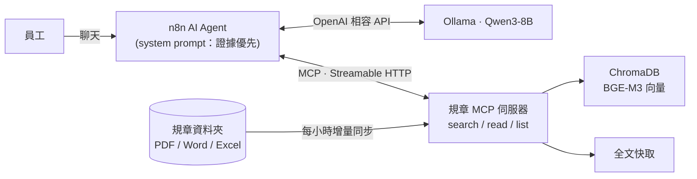

# 小芽：企業規章問答 Agent（MCP × n8n × 本地 LLM）

> ⚠️ 示範專案：「星芽科技」是虛構公司，`data/docs/` 裡的規章全部是假資料。

<!-- EVAL:START -->
<!-- 這段由 scripts/run_eval.py 自動產生，請不要手動修改 -->
**最新評測**（Python 版 agent）：候選 `v11d`，模型 `qwen3:8b（只在驗算時思考）`（[怎麼看這些分數](docs/evaluation.md#分數怎麼看)）

- 調整組 tune：**58/58**（100%），平均 9.7 秒／題，2026-10-27，CI 基準 ≥ 57
- 第 1 批隱藏組 holdout：**15/17**（88.2%），平均 10.1 秒／題，2026-10-27，CI 基準 ≥ 14
- 第 2 批隱藏組 holdout2：**16/17**（94.1%），平均 7.3 秒／題，2026-10-27，CI 基準 ≥ 15
- 第 3 批隱藏組 holdout3：**7/9**（77.8%），平均 6.9 秒／題，2026-10-27，CI 基準 ≥ 6
- 第 4 批隱藏組 holdout4：**14/14**（100%），平均 10.7 秒／題，2026-10-27，CI 基準 ≥ 13
- 第 5 批隱藏組 holdout5：**14/14**（100%），平均 10.6 秒／題，2026-10-27，CI 基準 ≥ 13
<!-- EVAL:END -->

> 📌 **分數為什麼跟下面的表格不一樣**：下面的改善前後表格是 10/22 用 Ollama 0.40.6 跑的 v9c（調整組當時 45 題）。10/23 本機 Ollama 升到 0.40.9，模型檔沒變；同一個候選、temperature 0 重跑，調整組 44/45、第 1 批隱藏組 13/17，錯題兩次一樣，判斷是環境變化（原因還沒證實）。第 7 輪（[紀錄](docs/harness.md#第-7-輪公式和喪假天數交給程式ollama-0409)）把新出現的錯誤類型換問法補進調整組（45 → 50 題）、換上全新的第 4 批隱藏組（14 題）、修正一個評分漏洞（v9c 調整組重新評分 47/50），再用程式檢查公式和喪假天數（v10c）。上面的分數區塊是 v10c 在現在環境的結果；沒被借題的第 2～4 批隱藏組跟 v9c 打平（32/43）。

員工用自然語言問公司制度（請假、補助、報銷……），Agent **一定先查文件再回答**，每個數字都附出處；文件沒寫的不猜，跟公司無關的問題直接拒答。整套跑在本機：Ollama（Qwen3-8B + BGE-M3）、ChromaDB、n8n（Docker）。


## 改善前後差異（一眼看懂）

同一個模型（Qwen3-8B，本機），模型本身完全沒訓練，只改 prompt 和流程（harness）。

| 指標 | 改善前（v0：手動調好的版本） | 改善後（v9c：改進循環 6 輪） | 差異 |
|---|---|---|---|
| 調整組 45 題（改進時看得到錯題） | 25/32 ※ | 45/45 | 大幅進步，但這組有被「針對」過 |
| 第 1 批隱藏組 17 題（沒看過錯題） | 14/17 | 15/17（v9c）；16/17（v3a） | +1～2 題 |
| 第 2 批隱藏組 17 題（全新題目） | 13/17 | 15/17 | +2 題 |
| 第 3 批隱藏組 9 題（第 5 輪換上，刻意出難題） | 5/9（v5） | 5/9 | 打平（v8 兩次跑出 6 和 5） |
| 第 4 批隱藏組 14 題（第 7 輪換上，Ollama 0.40.9） | | 12/14（v9c）；11/14（v10c） | 沒有 v0 的分數；差 1 題在誤差範圍內 |
| 平均回答時間 | 4.2～4.7 秒 | 8.2 秒 | 慢約 3～4 秒（數字題才開思考驗算） |
| n8n 版調整組 45 題 | | 44/45 | 同一套檢查移植到 n8n |
| 參考上限：全程思考 | | 17/17（第 1 批隱藏組） | 每題 19.5 秒，太慢不採用 |

※ v0 是在調整組還只有 32 題時跑的。

**有改善的**：多步計算（基準 × 倍數 × 月薪）、年資／年齡門檻判斷、口語稱謂對到條文（奶奶 → 祖父母）、採購／撥款類問題不再被誤判成無關而拒答。

**沒改善或還有問題的**：
- ~~名單外的對象（叔叔、舅舅）被硬套成「可以」~~ → 第 5 輪用程式做親屬稱謂對照修好（v8）；但「這一條有沒有列」還沒檢查（例：喪假有列配偶之父母、奠儀沒有）
- ~~文件沒寫「可不可以」的事（例：能不能預支旅費），模型會自己推論~~ → 第 6 輪用程式維護的「申請動作對照表」修好（預支、分期、代領、轉讓）；表外的動作還是會推論
- 第 6 輪（v8 → v9c）調整組 40 → 45，但三批隱藏組合計 35/43 → 35/43 **打平**：修好的是特定錯誤類型，泛化沒有可量測的進步
- 第 7 輪（v9c → v10c）調整組 47 → 50，沒被借題的第 2～4 批隱藏組 32/43 → 32/43 **打平**；Python 版的算式重算讀不到模型偶爾輸出的 LaTeX 算式
- 追問題只靠上一輪讀過的文件回答時，評分規則判錯（答案內容其實對）
- v5 多了一個副作用：明顯無關的問題（規劃日本旅遊）會先查文件再說找不到，而不是直接拒答
- 每次跑分同一題可能有 ±1 題的浮動，所以隱藏組 +1 題不能當作確定的進步

## 架構




## 設計重點

| 問題 | 做法 |
|---|---|
| 小切塊找得準，但會切掉但書 | **Small-to-big**：256 token 切塊（重疊 30）召回前 50 段 → 依文件聚合排序 → 最相關的那份直接回傳**全文**，其餘回傳段落 |
| 文件會更新、會刪除 | 背景每小時比對修改時間：改過的重建索引、刪掉的移出索引；全文另外快取，重啟不必重建 |
| LLM 憑常識亂答 | Prompt 規定「先查再答」、每句標 `[[檔名]]`、文件沒寫就請員工找人資、無關問題拒答 |
| 追問時模型拿上一題的文件直接說「找不到」 | Prompt 要求每題重新查；Python 版 agent 另有 harness 檢查：沒查任何文件就下結論，會被退回去先查 |
| 引用出處要讓人看得懂 | 模型輸出 `[[檔名]]`，n8n 回覆節點換成可點擊的檔案卡片（📘 Word／📕 PDF／📗 Excel），連到 MCP 伺服器的 `/docs/<檔名>` 開原檔（只開放規章資料夾裡的檔案） |
| 格式多 | PDF（修正中文斷行）、Word、Excel（每列轉成「欄位：值」，切塊後仍看得懂） |

## 快速開始

需要：Ollama、Docker Desktop、[uv](https://docs.astral.sh/uv/)

```bash
ollama pull bge-m3 && ollama pull qwen3:8b
uv sync
uv run python scripts/make_fake_docs.py      # 產生假規章
uv run policy-mcp                            # MCP 伺服器：http://127.0.0.1:8000/mcp

# 只用 Python 問答 / 驗收
uv run python agent/run_agent.py "婚假怎麼請？"
uv run python agent/run_agent.py --eval

# 完整評測（更新分數、基準、README 最上面的分數區塊），以及 CI 跑的檢查（不需要模型）
uv run python scripts/run_eval.py
uv run python -m pytest -q tests && uv run python scripts/check_regression.py

# n8n 版
cd n8n && docker compose up -d               # http://localhost:5678
# 建立兩個憑證：OpenAI（Base URL = http://host.docker.internal:11434/v1，API Key 隨便填）、Ollama（http://host.docker.internal:11434）
# 再用腳本產生工作流（含驗算分支）：python scripts/n8n_build_workflow.py
```

## 文件導覽

- [評測：驗收、CI 與本機跑分](docs/evaluation.md)：14 題驗收的版本演進、CI 檢查什麼、本機一行指令跑完整評測、分數怎麼看
- [自動改進循環（Harness）](docs/harness.md)：「改 → 測 → 留下有用的」流程，第 1～7 輪的候選與分數
- [n8n 版：驗算檢查與分流](docs/n8n.md)：n8n 的驗算分支、規章／數據分流、「沒查就拒答」檢查
- [檢索與計算機工具](docs/retrieval.md)：Small-to-big 檢索的做法與參數，`calculate` 工具
- [踩過的坑](docs/pitfalls.md)：n8n × Ollama × MCP 串接時遇到的問題
- [目錄](docs/structure.md)：各資料夾放什麼
