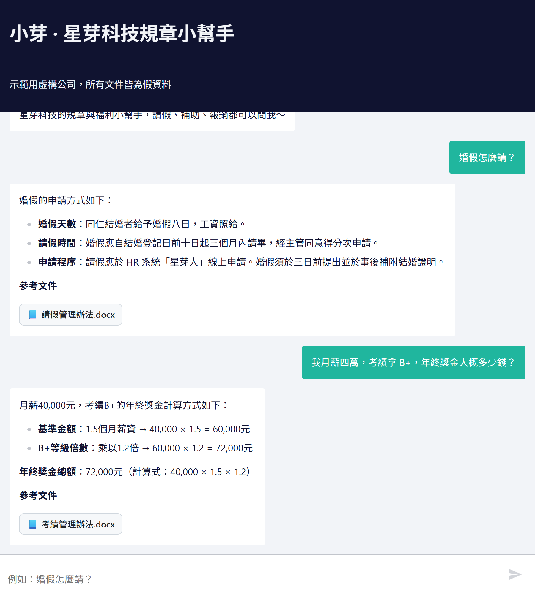
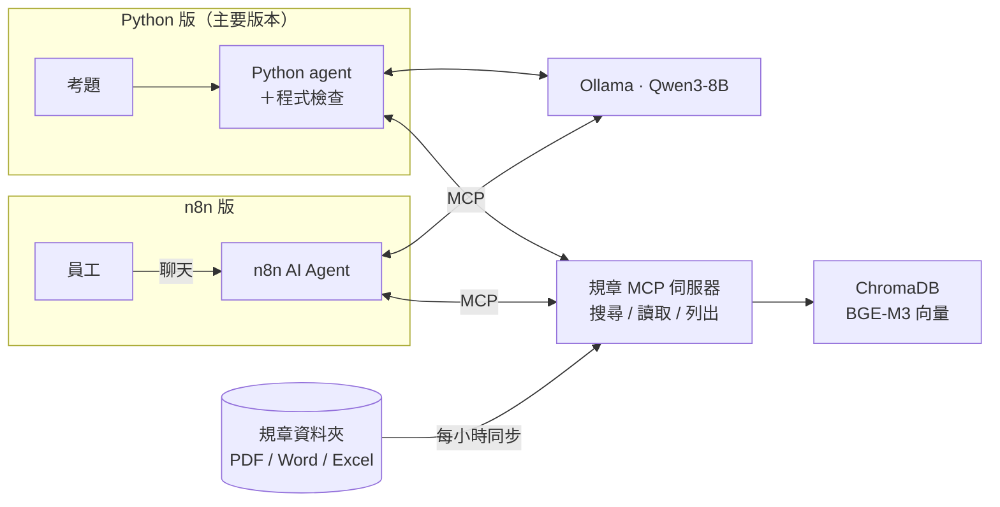
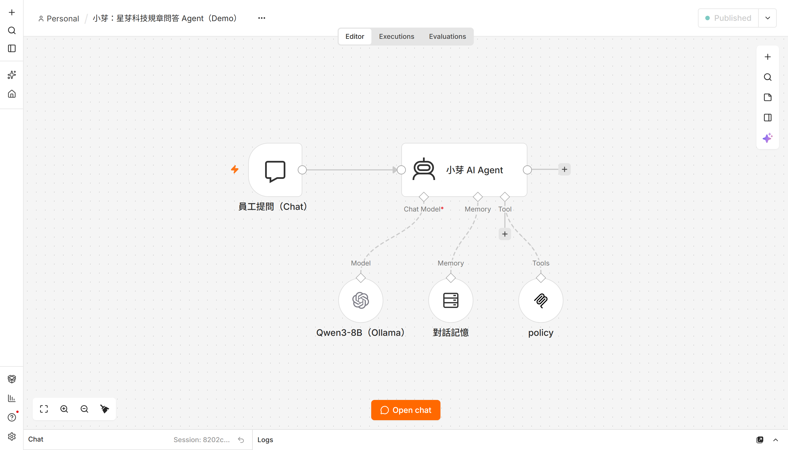

# 小芽：公司規章問答 Agent

[English](README.md) | 繁體中文

> ⚠️ 示範專案：「星芽科技」是虛構公司，`data/docs/` 裡的規章都是假資料。

員工可以用平常說話的方式問公司規定，例如「婚假可以請幾天？」「年終獎金怎麼算？」。小芽會先到規章裡找依據再回答，每個數字都附上出處；文件沒寫的不亂猜，跟公司無關的問題直接婉拒。

整套系統都在本機執行，資料不會送到外部服務：模型用 Ollama（Qwen3-8B），向量資料庫用 ChromaDB，聊天介面用 n8n。



## 它怎麼運作

1. 員工在聊天介面發問
2. Agent 呼叫規章 MCP 伺服器搜尋相關條文（MCP 是讓 AI 呼叫外部工具的標準介面）
3. 伺服器找出最相關的規章，回傳整份文件或相關段落
4. 模型根據條文回答，每句標出處；需要計算的題目，程式會再驗算一次



專案有兩個版本，共用同一台 MCP 伺服器：

- **Python 版**是主要版本，下面的評測分數都是用它跑的
- **n8n 版**把同一套做法放進 n8n 工作流，比較接近公司實際部署的樣子；後面幾輪新增的程式檢查（例如公式驗算）還沒搬過去



## 怎麼知道它答得對

我準備了兩種考題：

- **調整組（58 題）**：改進 Agent 時可以看錯在哪裡，像練習題
- **隱藏組（5 批）**：改進時不看題目，只拿來檢查有沒有真的變好，像正式考試

模型本身沒有重新訓練，只改 prompt 和程式流程。目前的分數：

<!-- EVAL:START -->
<!-- 這段由 scripts/run_eval.py 自動產生，請不要手動修改 -->
**最新評測**（Python 版 agent，版本 `v11d`，模型 `qwen3:8b（只在驗算時思考）`，[怎麼看這些分數](docs/evaluation.md#分數怎麼看)）

- 調整組：**58/58**（100%），平均每題 9.7 秒，2026-10-27，CI 最低要求 57 題
- 第 1 批隱藏組：**15/17**（88.2%），平均每題 10.1 秒，2026-10-27，CI 最低要求 14 題
- 第 2 批隱藏組：**16/17**（94.1%），平均每題 7.3 秒，2026-10-27，CI 最低要求 15 題
- 第 3 批隱藏組：**7/9**（77.8%），平均每題 6.9 秒，2026-10-27，CI 最低要求 6 題
- 第 4 批隱藏組：**14/14**（100%），平均每題 10.7 秒，2026-10-27，CI 最低要求 13 題
- 第 5 批隱藏組：**14/14**（100%），平均每題 10.6 秒，2026-10-27，CI 最低要求 13 題
<!-- EVAL:END -->

需要老實說明的地方：

- 每批隱藏組找到的新錯誤，下一輪會換個問法放進調整組練習，所以只有每批第一次考的成績，才是真正沒看過的題目
- 第 5 批是寫檢查程式的同一個 AI 出的題，滿分可能偏樂觀
- 同一題重跑，結果可能差一題左右，所以差一題不代表真的變好或變差

和最初的版本相比，調整組從 25/32 進步到 58/58，隱藏組第 1 批從 14/17 到 15/17、第 2 批從 13/17 到 16/17。代價是回答變慢，從每題 4～5 秒變成 7～11 秒左右，因為數字題會多一步驗算。每一輪改了什麼，寫在 [docs/harness.md](docs/harness.md)。

## 逐步追蹤：答錯時看是查錯還是答錯

Python 版可以把每一題的每一步（模型呼叫、工具呼叫與搜尋到的文件和相關度、觸發的程式檢查與重答、每一步耗時）寫成本機 JSONL，不用外部服務或 API 金鑰。n8n 版沒有追蹤。

```bash
uv run python agent/run_agent.py --eval --trace            # 或 TRACE=1；寫到 traces/<run-id>.jsonl（不 commit）
uv run python agent/trace_report.py traces/<run-id>.jsonl  # 錯題分類＋每一步耗時
```

錯題會依題庫的 `expect_file` 分成 `retrieval_miss`（查錯：預期文件沒被查到，含完全沒查）和 `generation_error`（答錯：查到了但答案錯）。開追蹤不會改變 agent 的行為（有單元測試比對），開追蹤跑調整組是 58/58。欄位說明和真實範例見[自動改進循環：逐步追蹤](docs/harness.md#逐步追蹤tracing)，範例檔是 `traces/example.jsonl`。

## 設計重點

| 遇到的問題 | 怎麼解決 |
|---|---|
| 條文切得太細，會漏掉但書 | 先用小段落找，找到後回傳最相關那份規章的全文（Small-to-big 檢索） |
| 規章會更新、會刪除 | 每小時檢查檔案，有變動就重建索引 |
| 模型憑常識亂答 | 規定先查再答、每句標出處；文件沒寫就請員工找人資 |
| 追問時沒重查就說「找不到」 | 程式檢查：沒查文件就下結論，退回去重查 |
| 數字算錯 | 程式從條文找出公式再驗算，對不上就退回重算 |
| 口語稱謂對不到條文（奶奶、老公的爸爸） | 程式內建親屬稱謂對照表 |
| 出處看不懂 | n8n 版把出處換成可點擊的檔案卡片，直接開原檔 |
| 檔案格式多 | 支援 PDF、Word、Excel |

## 快速開始

需要：Ollama、Docker Desktop、[uv](https://docs.astral.sh/uv/)

```bash
ollama pull bge-m3 && ollama pull qwen3:8b
uv sync
# 假規章已經放在 data/docs/；要重新產生：uv run python scripts/make_fake_docs.py
uv run policy-mcp                            # MCP 伺服器：http://127.0.0.1:8000/mcp

# 只用 Python 問答 / 驗收
uv run python agent/run_agent.py "婚假怎麼請？"
uv run python agent/run_agent.py --eval

# 完整評測（更新分數、基準、兩份 README 的分數區塊），以及 CI 跑的檢查（不需要模型）
uv run python scripts/run_eval.py
uv run python -m pytest -q tests && uv run python scripts/check_regression.py

# n8n 版
cd n8n && docker compose up -d               # http://localhost:5678
# 建立兩個憑證：OpenAI（Base URL = http://host.docker.internal:11434/v1，API Key 隨便填）、Ollama（http://host.docker.internal:11434）
# 再用腳本產生工作流（含驗算分支）：python scripts/n8n_build_workflow.py
```

## 更多文件

- [評測與 CI](docs/evaluation.md)：考題怎麼評分、CI 檢查什麼、分數怎麼看
- [自動改進循環](docs/harness.md)：每一輪改了什麼、分數怎麼變
- [n8n 版](docs/n8n.md)：驗算分支、問題分流
- [檢索方法](docs/retrieval.md)：Small-to-big 檢索的參數、計算機工具
- [踩過的坑](docs/pitfalls.md)：串接 n8n、Ollama、MCP 時遇到的問題
- [目錄結構](docs/structure.md)：每個資料夾放什麼

## 授權

[MIT](LICENSE)
