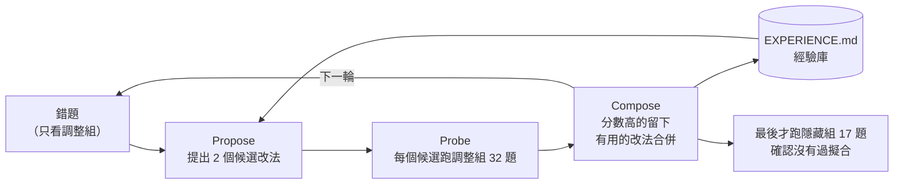
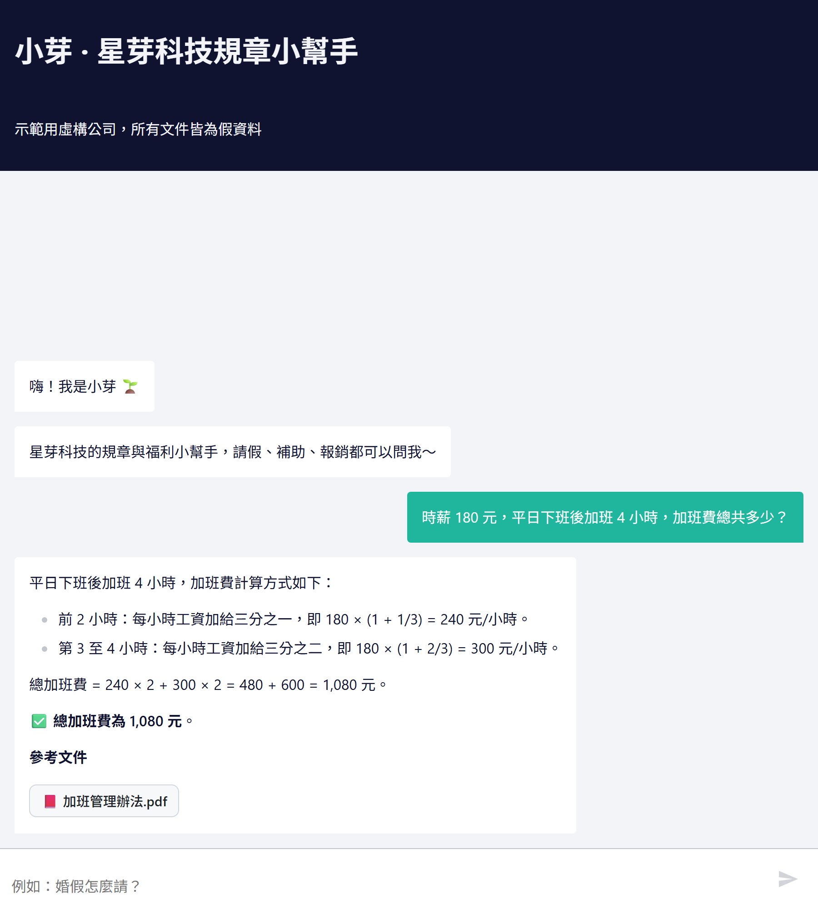

# 自動改進循環（仿 Harness²，`harness/`）

[← 回到 README](../README.md)

手動調了十幾個版本之後，把「改 → 測 → 留下有用的」這個循環做成固定流程，概念來自 [Harness²](https://github.com/google-research/harness2)：不動模型權重，只改模型外面那一圈（prompt、工具、檢查規則）。



| 元件 | 檔案 | 說明 |
|---|---|---|
| 候選 harness | `harness/candidates/<名稱>/` | `system_prompt.md`、`env.yaml`（開關）、`PROPOSAL.md`（改了什麼、根據哪些錯題） |
| 可以改的範圍 | `env.yaml` | `THINK`（思考模式）、`CALC_CHECK`（驗算檢查）、`RECHECK_MODE`（inline 同對話重算／fresh 開新對話只給文件）、`RECHECK_THINK`（只在驗算時思考）、`NUMERIC_TRIGGER`（問題有數字也觸發驗算） |
| 調整組 | `eval/tune.yaml`（32 題） | 改進循環**只能看這組的錯題** |
| 隱藏組 | `eval/holdout.yaml`（17 題） | 題型類似但題目不同；`loop.py fails --split holdout` 會直接拒絕，避免偷看 |
| 成績表 | `harness/scoreboard.csv` | 每次 probe 一列：候選、組別、通過數、平均秒數 |
| 經驗庫 | `harness/EXPERIENCE.md` | 每次改動的 change / verdict / lesson，下一輪 Propose 先讀 |

**誰來 Propose？** 這一版由開發用的 AI 助理（Claude）讀錯題和經驗庫後寫候選，`loop.py` 負責跑分和記錄；之後可以換成 API 自動呼叫。**目標**：不開思考模式（約 4 秒一題）的前提下，把正確率拉到接近全程思考模式（約 20 秒一題）。

## 第一次跑的結果（3 輪，詳細過程在 `harness/EXPERIENCE.md`）

| 候選 | 改了什麼 | 調整組 32 題 | 隱藏組 17 題 | 平均秒數 |
|---|---|---|---|---|
| v0 | 起點：手動調好的 prompt，快速模式 | 25 | 14 | 4.2 |
| v1a | 快慢雙路徑：問題涉及數字才驗算；驗算開新對話、不給草稿、只在驗算時思考 | 29 | | 7.5 |
| v1b | Prompt：稱謂對照（奶奶→祖父母）、金額千分位、找不到固定句 | 27 | | 4.1 |
| v2 | Compose：v1a ＋ v1b ＋ 查文件檢查改嚴格 | 30 | | 7.5 |
| **v3a** | 驗算 prompt：門檻結論要跟計算機一致、中文數字核對位數、不補文件沒寫的流程 | **32** | **16** | 7.7 |
| v3b | v3a ＋ 工具端把中文數字加註成「四千（4,000）元」 | 28（淘汰） | | 7.4 |
| vthink | 參考上限：全程思考模式 | | 17 | 19.5 |

- 隱藏組也從 14 進步到 16，改動不是只背了調整組
- v3a 用約 40% 的時間拿到接近全程思考的分數
- v3b 被淘汰：模型會把「六（6）日」這種加註格式照抄進答案。看起來合理的結構性改法也要實測
- v3a 在隱藏組錯的 1 題（採購問題被當成無關而拒答）是調整組沒涵蓋的新類型；下一輪要把這類問法補進調整組，並換一批新的隱藏組

## 第 4 輪：補上隱藏組找到的盲點

第 1 批隱藏組找到一個新的錯誤類型（採購問題被當成無關問題拒答）。做法：**不拿隱藏組原題來改**，而是換不同問法把採購、報帳、撥款、尾牙等 6 題補進調整組（32 → 38 題），並換上全新的第 2 批隱藏組（`eval/holdout2.yaml`）。

| 候選 | 改了什麼 | 調整組 38 題 | 第 2 批隱藏組 17 題 | 平均秒數 |
|---|---|---|---|---|
| v3a | 上一輪最佳 | 34 | 13 | 6.1～7.3 |
| v4a | Prompt：公司問題範圍加上採購、撥款、公司活動；不確定就先查 | 35 | | 7.4 |
| v4b | Harness：沒查就拒答時，程式自己搜一次，相關度 ≥ 0.5 就退回 | 35 | | 7.8 |
| **v5** | Compose：v4a ＋ v4b ＋ 問題含「公司、員工…」一律不准不查就拒答 | **36** | **14** | 6.4～7.5 |
| v0（參考） | 起點 | | 13 | 4.7 |

- 第 2 批隱藏組只多對 1 題，在誤差範圍內，不能說有顯著進步。誠實結論：調整組的進步大，泛化的進步小
- 隱藏組又找到新類型：「叔叔過世可以請喪假嗎？」條文沒列叔叔，模型卻套用別的親屬列說可以。記錄在 `harness/EXPERIENCE.md`，留給下一輪
- v5 已複製成正式版（`agent/system_prompt.md`、`agent/recheck_prompt.md`），**n8n 版也讀同一份檔案**

## 第 5 輪：名單外的對象（親屬稱謂由程式對照）

| 候選 | 改了什麼 | 調整組 42 題 | 平均秒數 |
|---|---|---|---|
| v5 | 上一輪最佳 | 36 | 7.8 |
| v6 | Prompt：名單外的對象回答找不到；文件沒寫可不可以就不要推論 | 36（沒用，淘汰） | 7.3 |
| v7 | 是非題另開對話、思考模式核對「條文有沒有明確支持」 | 37 | **16.0**（太慢，淘汰） |
| **v8** | 程式做親屬稱謂對照：問到條文沒列的親屬（舅舅、姑姑…），答案卻不是找不到 → 改成「條文沒有列 X」 | **38** | 8.0 |

- 第 3 批隱藏組（9 題，刻意出難題）：v5 5/9 → v8 6/9，樣本小，只能當參考
- 跟 Text-to-SQL 同一個結論：8B 模型不守「不要推論」這種規則，容易猜錯的對照交給程式最穩
- n8n 版同步：回覆節點加上同一份親屬對照；另外補上「沒查文件就直接回答」也要重答（同 Python 版的 DOC_CHECK），修好追問題「那膳雜費一天可以報多少？」編出不存在檔名的問題。**n8n 調整組 42 題：38/42**，分流 30/30

## 第 6 輪：剩下的錯交給程式檢查（`agent/checks.py`）

| 候選 | 改了什麼 | 調整組 45 題 | 平均秒數 |
|---|---|---|---|
| v8 | 第 5 輪採用版本 | 40 | 7.5 |
| v9 | 算式重算（ARITH_VERIFY）＋引用文件讀全文（CITE_READ）＋讓模型抽關鍵詞查條文（TERM_CHECK） | 36 | 8.1 |
| v9b | 關鍵詞改成程式維護的對照表；數字題沒寫算式也送驗算（SHOW_WORK） | 43 | 8.2 |
| **v9c** | 比對前去掉搜尋結果開頭重複的問題 | **45** | 8.2 |

三個檢查怎麼做：
1. **算式重算**：答案裡每個「算式 = 數字」用安全計算機（AST 白名單，不用 `eval`）重算；算錯就把「你寫 666.67，正確是 533.33」附上退回一次。例：時薪 200 加班 3 小時，公式對但乘法算錯
2. **引用文件讀全文**：答案引用的文件只看過片段 → 程式呼叫 `read_specific_document`，把全文給模型核對後重寫
3. **申請動作對照**：問題提到「預支／預借／借支」這類動作，查到的條文裡完全沒有任何寫法 → 回答文件沒有規定。跟第 5 輪的親屬對照同一招

失敗與修正：
- v9 讓模型自己抽關鍵詞，抽出「每年檢查」「延後使用」這種條文不會用的說法，**誤殺 6 題正確答案**。比對用的詞要由程式維護，不能交給模型
- v9b 預支兩題還是錯：搜尋結果第一行會重複使用者的問題（「搜尋「…預支…」的結果」），所以永遠找得到「預支」
- n8n 版第一次只有 40/45：n8n 的工具輸出是 JSON 字串、換行被跳脫，同一個「去掉標題行」寫法失效；改成不靠換行的寫法後 **44/45**，分流 30/30



另外：模型偶爾輸出 LaTeX（`$180 \times \frac{1}{3}$`），聊天視窗不會渲染；n8n 回覆節點先轉成一般算式，算式重算也用轉換後的文字。

隱藏組（各跑一次）：第 1 批 15/17（v8 15）、第 2 批 15/17（v8 14）、第 3 批 5/9（v8 重跑也是 5）。合計打平，**這輪的進步只在調整組**。引用全文核對還沒移植到 n8n（n8n 中間沒辦法插入「程式讀全文再重寫」，要多接一個 Agent）。

## 第 7 輪：公式和喪假天數交給程式（Ollama 0.40.9）

10/23 本機 Ollama 從 0.40.6 升到 0.40.9（模型檔沒變），v9c 用 temperature 0 重跑，調整組 44/45、第 1 批隱藏組 13/17，錯題兩次一樣，判斷是環境變化（原因還沒證實）。這輪先處理新環境下冒出來的錯。

題目變動：
- 第 1 批隱藏組暴露的兩種錯誤類型（年終漏乘考績倍數、追問換親屬答錯天數）**換問法**補進調整組 4 題，加班費同類型再補 1 題，調整組 45 → 50 題。代價是第 1 批隱藏組對這兩種錯誤類型已經不算「沒看過」
- 換上全新的第 4 批隱藏組（`eval/holdout4.yaml`，14 題），在看任何第 7 輪結果之前寫好

評分規則修正：「如果是我太太呢？」（前一題問岳母）v9c 結論寫「配偶喪假十四日」，可是引用條文時寫到「八日」，原本只檢查「正確數字有沒有出現」就判對了。補上 `must_not_contain`（答案出現就判錯），v9c 調整組用存下的答案重新評分，**48/50 → 47/50**（沒重跑模型）。

| 候選 | 改了什麼 | 調整組 50 題 | 平均秒數 |
|---|---|---|---|
| v9c | 第 6 輪採用版本（評分修正後） | 47 | 8.8 |
| v10a | 公式由程式從條文解析（FORMULA_CHECK）：年終＝月薪 × 基準月數 × 考績倍數、平日加班費分段加給；答案沒有應得數字就附公式退回 | 49 | 9.0 |
| v10b | 喪假天數由程式對照（KIN_LOOKUP）：問到的親屬在條文哪一句，答案數字不一致就退回，再錯就直接用那一句回答 | 48 | 8.6 |
| **v10c** | v10a ＋ v10b（prompt 沒改） | **50** | 9.2 |

v10a 修好兩題計算、v10b 修好配偶喪假，兩邊都沒有題目變錯，合起來剛好 50/50。公式和親屬名單都是從**查到的條文**解析，沒有寫死在程式裡。

隱藏組（v10c 各跑一次；v9c 是同一個環境 10/26 跑的，第 4 批另外跑一次當對照）：

| 隱藏組 | v9c | v10c |
|---|---|---|
| 第 1 批（17 題，錯誤類型已借進調整組） | 13 | 15 |
| 第 2 批（17 題） | 15 | 15 |
| 第 3 批（9 題） | 5 | 6 |
| 第 4 批（14 題，這輪新換上） | 12 | 11 |
| 合計 | 45/57 | 47/57 |

- +2 都在第 1 批，而它的錯誤類型這輪已經補進調整組；沒被借題的第 2～4 批 **32/43 對 32/43，打平**。跟第 6 輪一樣，修好的是特定錯誤類型，泛化沒有可量測的進步
- 第 4 批不算完全隱藏：寫 v10b 的 agent 動手前看過新增題目的 commit，上下文裡有第 4 批的題目，KIN_LOOKUP 的「最長優先（曾祖母只算曾祖）」「兩個稱謂就跳過」可能受影響。結果 v10c 在第 4 批的親屬題沒有比 v9c 好（「先生的祖父母」v10c 答錯），分數沒有因此灌水
- 第 4 批還錯的類型（只記錄，不拿來改）：加班費分段時模型用 LaTeX 寫算式，**Python 版的算式重算讀不到 LaTeX**，算錯沒被抓到，FORMULA_CHECK 退回一次也沒救回；兩個稱謂的親屬（先生的祖父母）；文件沒寫的福利（托兒津貼）
- v10c 已複製成正式版（`agent/production_env.yaml`；prompt 跟 v9c 一樣，不用改）。FORMULA_CHECK、KIN_LOOKUP 還沒移植到 n8n

## 第 8 輪：兩個稱謂的親屬、文件沒寫的福利、LaTeX 算式

處理第 4 批隱藏組還錯的三種類型。順序照方法論：

1. **先寫全新的第 5 批隱藏組**（`eval/holdout5.yaml`，14 題），在第 8 輪任何調整、跑分之前單獨 commit
2. 再把三種類型**換問法、換數字**補進調整組 8 題（50 → 58）：時薪 260／150 的平日加班、妻子的祖母、追問「那我太太的媽媽呢？」、丈夫的姊姊（名單沒列）、生日禮金、手機通訊費、團體保險。代價：**第 4 批對這三種類型從此不算沒看過，第 5 批是唯一沒被借題的一批**

| 候選 | 改了什麼 | 調整組 58 題 | 平均秒數 |
|---|---|---|---|
| v10c | 第 7 輪採用版本 | 55 | 9.6 |
| v11a | LaTeX 算式先轉成一般算式再重算（LATEX_PLAIN）；公式退回一次還錯就用程式算出的公式回答（FORMULA_FALLBACK） | 55 | 9.5 |
| v11b | 兩個稱謂的親屬由程式組成條文用語（KIN_COMPOUND）：太太的媽媽 → 配偶之父母；名單沒列（配偶之兄弟姊妹）→ 找不到 | **58** | 9.8 |
| v11c | 問到的福利在整個文件庫都沒出現 → 找不到（BENEFIT_CHECK） | 55 | 9.7 |
| **v11d** | v11a ＋ v11b ＋ v11c（prompt 沒改） | **58** | 9.7 |

- v10c 錯的 3 題全是兩個稱謂的親屬（把「妻子的祖母」當祖父母答六日、「太太的媽媽」答十二日、「丈夫的姊姊」說可以請三日），v11b 全修好，沒有題目變錯
- v11a、v11c 在調整組**量不出進步**：v10c 這次在新補的加班費題沒有輸出 LaTeX、文件沒寫的福利也答對了。沒有題目變錯，而且是確定性的程式檢查（有單元測試），所以一起合併；有沒有用要看隱藏組
- 三個檢查都是從文件原文判斷：親屬名單從查到的條文解析，福利比對整個文件庫的原文，沒有寫死答案
- 已知限制：「員工生日公司會發禮金嗎？」福利檢查抓不到，因為「生日」在「事實發生日」裡找得到（中文沒有斷詞，子字串比對的極限）。這題模型自己答對

隱藏組（v11d 各跑一次；v10c 第 5 批另外跑一次當對照，第 1～4 批沿用第 7 輪的結果）：

| 隱藏組 | v10c | v11d |
|---|---|---|
| 第 1 批（17 題） | 15 | 15 |
| 第 2 批（17 題） | 15 | 16 |
| 第 3 批（9 題） | 6 | 7 |
| 第 4 批（14 題，三種錯誤類型這輪已借進調整組） | 11 | 14 |
| **第 5 批（14 題，這輪新換上）** | **10** | **14** |
| 合計 | 57/71 | 66/71 |

- 第 5 批 +4：3 題兩個稱謂的親屬（老婆的爺爺、追問老公的爸爸、太太的外婆的奠儀），1 題文件沒寫的福利（子女教育補助）
- 第 2、3 批各 +1 也是 KIN_COMPOUND（「配偶的祖父母」喪假、「配偶的父母」奠儀：條文沒列 → 找不到）。這兩題在第 5 輪就被記錄過，是同一類錯誤
- 第 4 批 +3：兩個稱謂的親屬、托兒津貼（BENEFIT_CHECK），加班費這次答對是因為模型沒輸出 LaTeX、原本的公式檢查和算式重算就救回來了，**LATEX_PLAIN 和 FORMULA_FALLBACK 這輪在隱藏組都沒有實際觸發**，效果還沒驗證
- **誠實的限制**：第 5 批是寫第 8 輪檢查的同一個 agent 出的題，寫檢查時知道這批題目的寫法（例如「太太的外婆」的奠儀、「子女教育補助」），也讀過第 1～4 批的題目。結果是第一次跑、沒有依結果調整，但 14/14 應該當成偏樂觀的上限；要確認泛化，下一輪的新隱藏組最好由沒看過檢查程式的人或 agent 出題
- 第 1 批還錯的「交通車」（答「沒有提供」但沒建議洽人資）沒有福利詞，BENEFIT_CHECK 不處理；三題「無關問題應拒答卻先查了文件」（拉麵店、日本自由行、高鐵時刻表）是第 4 輪 v4a 留下的副作用，這輪沒處理
- v11d 已複製成正式版（`agent/production_env.yaml`；prompt 跟 v10c 一樣）。第 8 輪的檢查還沒移植到 n8n
- 基準：調整組題數改了、加了第 5 批，用 `run_eval.py --candidate v11d --from-existing --accept` 直接換成這次的結果（`--from-existing`：隱藏組已經各跑過一次，不再跑第二次）

## n8n 版套用 v5

`scripts/n8n_build_workflow.py` 直接讀 `agent/system_prompt.md` 和 `agent/recheck_prompt.md` 產生工作流，所以 Python 版選出來的 prompt 不用手動貼進 n8n。驗算檢查節點也跟 Python 版對齊（拒答不驗算、只把含 `[[檔名]]` 的文件內容交給驗算 Agent）。

- n8n 版在 38 題調整組：**36/38、35/38**（兩次獨立跑，平均 8.6～9.0 秒；`python eval/run_n8n_eval.py --questions eval/tune.yaml`）。另有一次跟別的 GPU 工作同時跑，掉到 33/38：本機 8B 模型在負載下輸出會變，正式跑分要獨占 GPU
- 錯的 2 題都是「應該說找不到」的題目，其中「尾牙」是因為 n8n 版沒有 v4b 的程式拒答檢查（只有 prompt）
- n8n 的評分沒有檢查「有沒有讀全文」（拿不到 Python 版那麼細的工具紀錄），所以比 Python 版寬鬆一點

```bash
python harness/loop.py new v1a --from v0      # 複製候選
python harness/loop.py probe v1a              # 跑調整組
python harness/loop.py fails v1a              # 看錯題（只限調整組）
python harness/loop.py diff v0 v1a            # 逐題比較
python harness/loop.py probe v2 --split holdout2  # 最後才跑隱藏組（第 1 批已用過）
python harness/loop.py rescore v2 --split tune     # 評分規則修正後，用存下的答案重新評分
```
