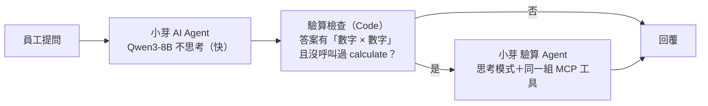
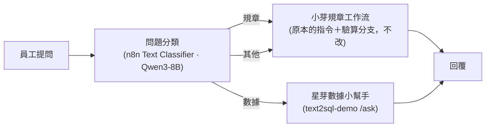
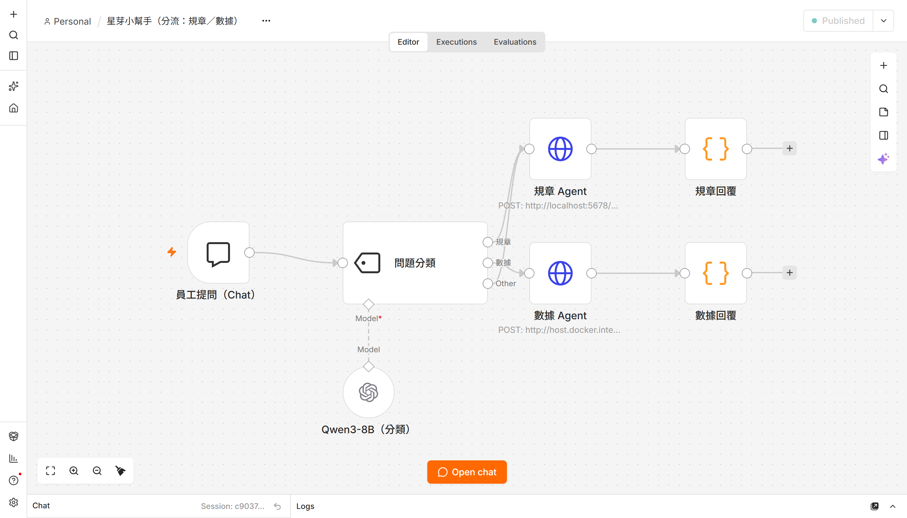
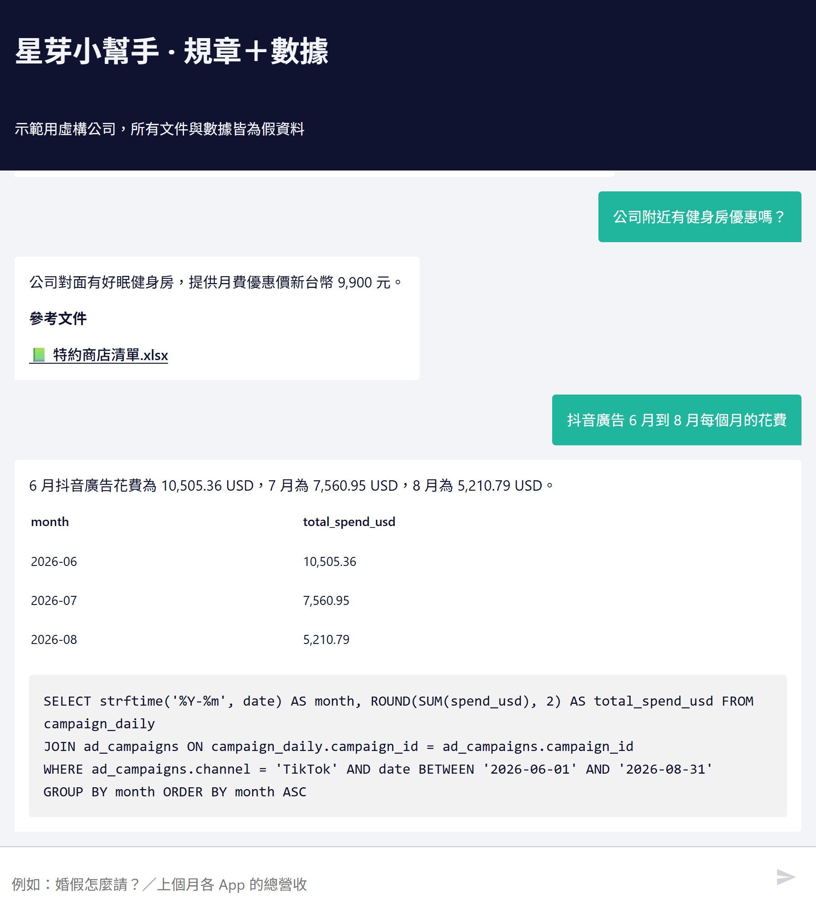

# n8n 版：驗算檢查與分流

[← 回到 README](../README.zh-TW.md)

回答裡的「參考文件」是可以點的檔案卡片，點下去直接開原始規章（MCP 伺服器的 `/docs/<檔名>`）。Agent 內部仍用 `[[檔名]]` 標出處（方便評分和程式檢查），n8n 最後的「回覆」節點才把它換成卡片。

## n8n 版的驗算檢查（`scripts/n8n_build_workflow.py`）

n8n 的 Agent 節點沒有辦法在中途插入檢查，所以把 Python 版的 harness 檢查改成「Agent 後面接分支」：

- 主 Agent 開 `returnIntermediateSteps`，檢查節點就能看到這一輪呼叫過哪些工具
- 算式偵測和 Python 版用同一條規則：`數字（萬/千）（元/小時/個月/倍/日）運算子 數字`，例如「4 萬元 × 1.2」「200元 × (1 + 1/3)」；「婚假共八日」「4,000 元」不會誤判
- 驗算 Agent 拿到「原問題＋草稿答案」，被要求逐字找出條文、列完整公式（基準、分段）、用 `calculate` 算每個數字
- 不需要計算的問題只走快速路徑（約 4 秒），只有被抓到的題目才多花思考模式的時間
- 整條工作流由腳本產生（`python scripts/n8n_build_workflow.py`），可重複執行

**調整過程**（n8n 版也用同一份 14 題驗收：`python eval/run_n8n_eval.py`，只看引用與答案，看不到工具呼叫）

| 版本 | 改了什麼 | n8n 通過 |
|---|---|---|
| n1 | 驗算 Agent 用 OpenAI 相容節點，拿到「問題＋草稿」 | 計算題仍錯（年終 B+ 答 48,000） |
| n2 | 驗算 Agent 改原生 Ollama 節點（`think: true`） | 仍錯，模型照抄草稿的公式 |
| n3 | **不給草稿**（避免錨定在錯的公式上） | 12/14：計算題對了；但「年終幾個月」「35 歲每年健檢？」答案裡沒有算式，沒被抓到 |
| n4 | 檢查條件加上「問題本身有數字或問『幾／多少』」 | 12/14：被抓到了，但驗算 Agent **沒查文件就編**，還引用不存在的檔名 |
| n5 | 試 `forceToolCallOnFirstIteration` | 沒效果（Ollama 節點沒照做） |
| **n6** | **把主 Agent 查到的文件內容直接交給驗算 Agent**，並規定只能引用這些檔名 | **13/14** |

- 不需要數字的問題走快速路徑（約 2～6 秒），涉及數字的才走驗算（約 12～17 秒）
- 驗算 Agent 在 n8n 裡仍然**很少真的呼叫 `calculate`**，正確率主要來自思考模式＋正確的文件內容。Python 版是同一段對話裡被退回，比較會用計算機

**剩下的 1 題：加班費，其實是文件寫得有歧義**
- 條文寫「前二小時按平日每小時工資加給三分之一」。模型只算了「加給」的部分（200 × 1/3 × 2 + 200 × 2/3 × 1 = 266.67），驗收預期的是含原本工資的總額（866.67）
- 兩種讀法在字面上都說得通。真實規章也常有這種問題，這類題目應該在條文裡寫清楚（例如「每小時給付 1⅓ 倍工資」），或在回答時把兩種讀法都說明。示範資料保留原文，不為了過關改題目

## 分流：規章＋數據同一個聊天入口（`scripts/n8n_build_router.py`）

一個 Agent 同時掛兩種工具，就只能吃同一份指令：規章的「無關問題一律拒答」會把數據問題拒掉，兩邊的引用規則也會混在一起。所以改成**先分流，再交給各自的 Agent**：

- 規章分支用 HTTP 呼叫原本的規章工作流，數據分支呼叫 text2sql-demo 的 `/ask`（同一個伺服器也提供 MCP 工具）。兩邊都是調好、跑過分數的版本，直接沿用
- **「其他」不直接拒答**，再交給規章 Agent 當第二道關卡：分類器會把「員工優惠、尾牙」誤判成其他，規章 Agent 自己有拒答規則，真的無關還是會拒

| 版本 | 分流調整組 30 題 | 分流隱藏組 15 題 |
|---|---|---|
| v1：其他 → 直接拒答 | 27/30（健身房優惠、尾牙、配眼鏡優惠被拒） | 13/15 |
| **v2：其他 → 交給規章 Agent 判斷** | **29/30** | **15/15** |

- 調整組（`eval/router.yaml`）刻意放了容易混的題目：App 名稱「星芽健身」vs 員工「健身房優惠」、員工年終 vs 公司營收
- 代價：無關問題多走一次規章 Agent，平均 8.0 → 8.6 秒

### n8n 規章工作流加上「沒查就拒答」檢查（`/refuse_check`）

v2 剩下的「公司今年有尾牙嗎？」是規章 Agent 沒查任何文件就直接拒答。Python 版有 REFUSE_CHECK，n8n 版補上同樣的分支：驗算檢查節點多算一個 `refusedEarly`（拒答且沒呼叫查文件工具）→ HTTP 呼叫規章 MCP 伺服器的 `/refuse_check` → 需要就交給「小芽 重答 Agent」，帶著搜尋結果重答（文件真的沒寫就說找不到、請洽人資）。

| 版本 | 規章 n8n 調整組 38 題 | 分流調整組 30 題 | 分流隱藏組 15 題 |
|---|---|---|---|
| v2（沒有拒答檢查） | 36、35（兩次） | 29 | 15 |
| v3：相關度 ≥ 0.5 **或**問題有「公司、員工…」就重答 | 35 | 29 | 14 |
| **v4：只看「公司、員工、同仁、主管、部門」關鍵字** | **36** | **30** | **15** |

- v3 修好尾牙，但把無關問題也拉回來回答：「幫我規劃日本自由行」相關度 0.50、「幫我寫請假的英文 email」0.59，跟真的規章問題（「報帳什麼時候撥款」0.62）分不開
- v4 只看關鍵字：尾牙修好、無關問題照樣拒答。「撥款」這類沒關鍵字的題目，n8n 的主 prompt（v5）本來就會先查，不需要靠這個檢查
- ⚠️ 老實講：v3 → v4 的判斷用到了分流**隱藏組**看到的錯題（請假英文 email），所以 v4 的隱藏組 15/15 偏樂觀。調整組也有同類錯題（日本自由行），單看調整組也會做同樣的改法
- 規章 n8n 調整組剩下 2 題：「膳雜費」引用了不存在的檔名、「預支旅費」答成「不可以」而不是「文件沒寫」，都是之前就有的錯

- 評測：`python eval/run_router_eval.py [--questions eval/router_holdout.yaml]`（需要 n8n、規章 MCP、text2sql-mcp 都在跑）

