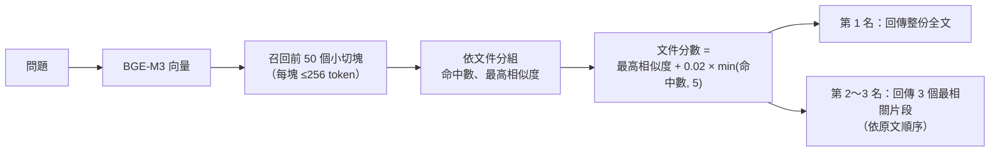

# 檢索與計算機工具

[← 回到 README](../README.md)

## Small-to-big 檢索怎麼做（`src/policy_mcp/indexer.py`、`server.py`）

核心想法：**用小塊找、用大塊答**。小塊的向量比較「純」，搜得準；但回答需要完整上下文（但書、例外、申請條件），所以找到之後要放大回去。

1. **建索引：小切塊**
   - 先依句號、分號、換行切成句子，再把句子裝進 256 token 的箱子（用 tiktoken 估算）。以句子為單位，所以不會把一句話切成兩半
   - 相鄰兩塊重疊約 30 token：下一塊會帶上一塊結尾的句子，跨塊的條文不會斷掉
   - 每一塊記錄 `file`（哪份文件）和 `pos`（第幾塊），存進 ChromaDB（cosine 距離）
2. **查詢：先多撈小塊**
   - 問題向量化後，從 ChromaDB 撈前 50 個最像的小切塊。撈多一點是為了讓「同一份文件有好幾段都相關」這個訊號浮出來
3. **聚合：小塊歸回文件**
   - 依 `file` 分組，算每份文件的命中段數和最高相似度
   - 文件分數＝最高相似度＋0.02 × 命中數（最多算 5 段）。以最佳片段為主，多處相關的文件小幅加分
4. **放大：回傳大塊**
   - 第 1 名直接回傳**整份全文**（全文另外存在快取，不用重新讀檔），條件與但書不會被切掉
   - 第 2、3 名只回傳 3 個最相關片段，依原文順序排好，需要時 agent 再用 `read_specific_document` 讀全文
   - 文件超過 4,000 字就不附全文，改回傳片段（避免塞爆小模型的 context）

**為什麼這樣調**（看驗收數據決定的）
- 只回片段 → 模型常常跳過「讀全文」，漏掉但書（v2：7/10）
- 前 2 名都附全文 → 8B 模型被資訊淹沒，把所有規章都整理一遍（v3）
- 只附第 1 名全文、只回前 3 名 → 9/11（v4）

**限制**：這批規章每份都很短，所以「放大」直接放大到整份文件。正式環境的長文件（幾十頁的手冊）應該放大到「所屬章節」或「前後幾塊」，而不是整份。可調參數：`FULLTEXT_DOCS`、`FULLTEXT_MAX_CHARS`、`TOP_FILES`（環境變數）。

## 計算機工具（`src/policy_mcp/calc.py`）

8B 模型心算常出錯（例如 1.5 × 1.5 答 1.5），所以 MCP 多提供一個 `calculate` 工具：

- 支援 `+ - * / ** ( )`、比較（`35 >= 40` → 不成立）、`and / or`、`round/min/max/abs`，也接受 `×`、`÷` 和千分位逗號
- **用 Python AST 白名單解析，不用 `eval`**：`__import__("os")` 這類程式碼會被拒絕；次方上限防止算爆
